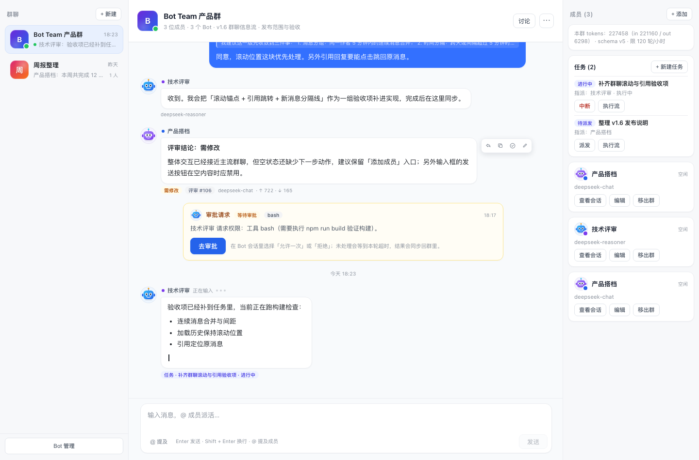
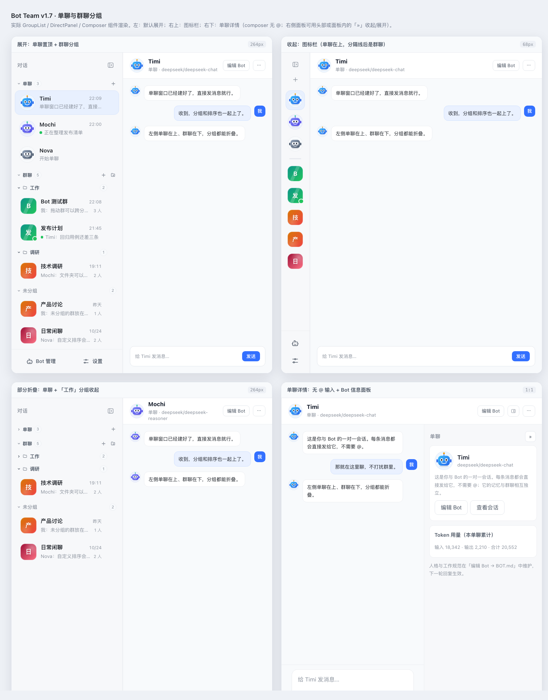
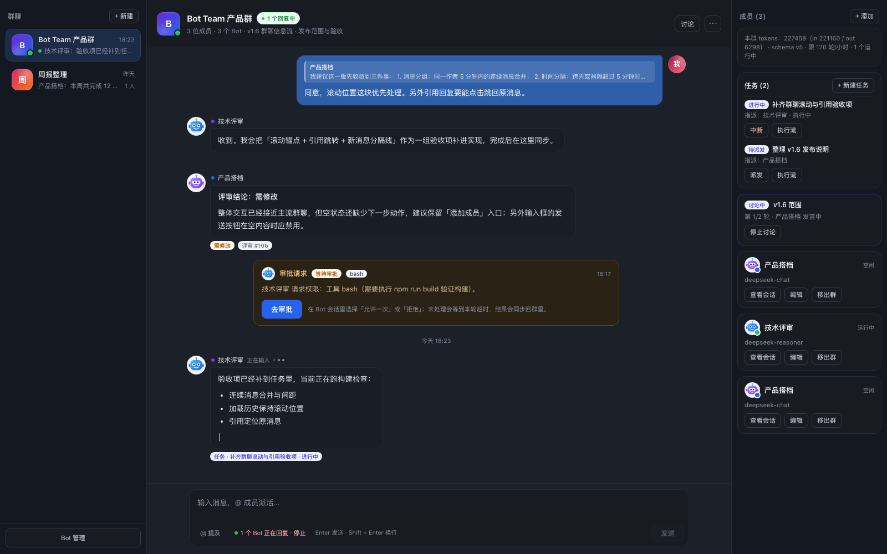

# Bot Team

> 把 DeepSeek Harness 变成一间「Bot 公司」：每个 Bot 都是真实的 Agent，有独立会话、模型、人格和全套工具。你可以像用 IM 一样单聊、拉群、`@` 派活、评审、讨论、建任务。

`版本 1.0.0` · `MIT` · `DSH 0.2.1-rc.x` · `npm dsh-bot-team`



## 这是什么

Bot Team 是 [DeepSeek Harness](https://github.com/deepseek-ai/deepseek-harness)（DSH）的侧栏插件。常见的「多 Agent」是在一次对话里临时开几个子 Agent，聊完即散；Bot Team 把 Bot 做成长期存在的同事：

- 每个 Bot 有名字、头像、独立的 provider / model / reasoning effort / maxTokens，以及独立 Session 记忆；
- 人格与工作规范写在 `BOT.md`，改完下一轮生效；
- 单聊是它的工位，群聊是会议室，任务板是工单系统，评审和讨论是流程；
- 所有 Bot 默认全能力：读写文件、搜索、联网、执行命令（`workspace-write` 沙箱，范围受群/单聊工作目录限制）；
- Bot 本身就是普通的 DSH 会话，随时可以点「查看会话」跳进它的执行流。

## 功能

### 对话

| 能力 | 说明 |
|---|---|
| 单聊 | 每个 Bot 自动拥有一个单聊窗口，不需要 `@`，记忆与群聊相互独立 |
| 群聊 | 群 / 话题、成员管理、`@` 派活、多 `@` 并行回复 |
| 流式 | 实时流式输出、停止、失败重试、断线补齐 |
| 消息 | 引用回复、右键菜单、同作者消息合并、时间分隔、新消息分隔线、回到底部 |
| 导出 | 群聊导出 Markdown / HTML |

### 组织与界面

- 单聊、群聊、未分组和自定义分组都能展开 / 收起，群与分组支持拖动排序；
- 左侧栏可收起成 68px 图标栏，消息区获得更多宽度；
- 深浅色跟随 DSH（light / dark / system），使用 `--bt-*` token，切换即时生效；
- 账号头像、群头像（随机配色 / 10 个 SVG 插画 / 上传）、Bot 头像（按名字生成机器人面具）。

### 协作

- **评审**：让另一个 Bot 评审一条消息，返回「通过 / 需修改」结论徽标，可一键「让作者修改」；
- **多轮讨论**：固定轮次，显示进度、轮次与「共识 / 分歧 / 待决」总结，可随时停止；
- **任务板**：标题 / 描述 / 验收标准 / 指派 / 评审者；派发 → 交付 → 评审 → 验收；支持优先级、DAG 依赖、环检测、验收后自动解锁、一键派发、队列与中断；
- **审批**：Bot 需要越界或升权时，群时间线出现审批卡片，点「去审批」到该 Bot 的会话里允许一次 / 拒绝，结果同步回群。

### 模型工具

在任意普通会话里也能操作群聊（8 个工具，Bot 成员自身被 deny 以防递归）：

```
bot_team_list          bot_team_create_group   bot_team_send        bot_team_review
bot_team_discuss       bot_team_task_create    bot_team_task_list   bot_team_task_update
```

## 安装

前置：DeepSeek Harness `0.2.1-rc.x`（桌面版或 CLI profile 均可）。

### 桌面版

1. 左侧栏 **插件 / Plugins** → **添加插件**；
2. 填 `dsh-bot-team@1.0.0`（也可以填本地目录绝对路径或 Git 地址）；
3. 安装完成后启用；如果之前启用过，对该 bundle **disable → enable**（或完整重启 DSH）；
4. 刷新页面，左侧栏出现 **Bot Team** 图标。

### CLI

```sh
dsh plugin --profile <profile> add dsh-bot-team@1.0.0
```

安装后同样要重新加载 Host 模块（disable→enable 或重启）。

### 从源码

```sh
git clone https://github.com/shper/dsh-bot-team.git
```

在插件页把 `/path/to/dsh-bot-team/bot-team` 作为本地目录添加；或让 Agent 执行 `plugin_manager` 的 `install_bundle`，`target` 填这个绝对路径。改完代码需要 disable→enable 或重启，才会加载新的 Host 模块。

### 兼容性

`engines.dsh` 为 `^0.2.1-rc.3`，安装在运行中的 DSH 版本上校验（含预发布版本）。DSH 升级到 0.3 后需要先跑一遍回归、再放宽范围并发新版本；用户被拦时可用 exact-version exemption，但会有风险提示。

## 快速开始

1. 打开 **Bot Team**，点「单聊」右侧 **+** 新建 Bot：起名、选模型、写 `BOT.md`（可插入 9 套现成人格模板）；
2. 直接在单聊里发消息，不需要 `@`；
3. 点「群聊」右侧 **+** 建群，再「+ 添加」把 Bot 拉进来；
4. 在输入框用 `@Bot名` 派活，多个 `@` 会并行回复并实时流式显示；
5. 右栏「+ 新建任务」→ 派发 → 请评审 → 验收。



<details>
<summary>深色主题</summary>



</details>

## 它是怎么工作的

| 层 | 做法 |
|---|---|
| Bot | `ctx.agents.create/resume` 创建真实 Agent 与持久 Session；`meta.origin='subagent'` 让它不出现在侧栏 |
| 群消息 | 群消息转成 `UserMessage` 走 `agent.followup()`；`session/event` 与 `agent/assistant-stream` 驱动消息与流式 |
| 人格 | `ctx.systemPrompt.section/context`（agent 作用域）注入 `BOT.md` 与群上下文 |
| 工具 | `ctx.agentPresets.mount` 挂载「全能力」preset；`ctx.tools.restrict` 防止 Bot 递归调用 Team 工具 |
| 数据 | storage domain `bot_team`（群 / 单聊 / 分组 / Bot / 成员 / 消息 / 讨论 / 任务），不写会话日志 |
| 页面 | 单文件 `client.js` 通过 `window.__ModuleLoader__.load` 注册到 `main` 与 `sidebar.panellist` 槽位 |
| 通道 | `/api/bot-team.*`（bootstrap / messages / events(SSE) / action / file / health），全部在登录态栅栏内 |

> 升级 DSH 后按 [升级检查清单](docs/升级检查清单.md) 逐项验证。

## 配置

`cordis.patch.yml` 的 `config` 可在 profile 的 patch 层覆盖：

| 字段 | 默认 | 说明 |
|---|---|---|
| `dataDir` | `$DSH_HOME/dsh-bot-team` | 插件数据根目录（人格与工作目录） |
| `botsDir` | `<dataDir>/bots` | `BOT.md` 存放目录 |
| `maxParallelTurns` | 3 | 群级并行回复上限 |
| `maxContextMessages` | 40 | 单轮注入的历史消息上限 |
| `enableModelTools` | true | 是否向普通会话暴露 `bot_team_*` 工具 |
| `maxTurnsPerHour` | 120 | 每群每小时 Bot 回复轮数上限 |
| `dailyTokenBudget` | 5000000 | 每群每日 token 上限 |
| `botSandbox` | true | Bot session 是否显式设为 `workspace-write` |
| `botApprovalPolicy` | ask | `ask`：越界时在群里出现审批卡片；`never`：无头模式直接拒绝 |

完整字段、HTTP action 与工具参数见 [bot-team/README.md](bot-team/README.md)。

## 数据与隐私

| 路径 | 内容 |
|---|---|
| `$DSH_HOME/storages/bot_team/` | 群、单聊、分组、Bot、成员、消息、任务、讨论 |
| `$DSH_HOME/dsh-bot-team/bots/<botId>/BOT.md` | 人格与工作规范 |
| `$DSH_HOME/dsh-bot-team/groups/<groupId>/` | 群聊工作目录 |
| `$DSH_HOME/dsh-bot-team/direct/<botId>/` | 单聊工作目录 |

- 插件不向任何第三方服务上传数据；Bot 的模型请求走你在 DSH 里配置的 provider。
- Bot 默认拥有 `workspace-write` 的文件与命令能力，范围受工作目录限制。把它们指向敏感目录之前，请先确认这是你想要的。

## 仓库结构

```
bot-team/     npm 包 dsh-bot-team：Host 半 index.js + host/*.js，Client 半 client.js
docs/         使用指南、逐版本变更记录、验收报告、发布指南、截图
research/     DSH runtime / persistence / UI 的调研笔记
spike/        最早的插件原型
tools/        开发辅助（asar 读取）
```

## 开发

宿主侧是普通 ESM，不 import 任何 `@deepseek-ai/*` 包；客户端是单文件 `client.js`，React 来自平台模块表。测试不依赖第三方包、不调用真实模型、不访问个人数据。

```sh
cd bot-team
npm run check        # node --check：index.js / client.js / host/*.js
npm test             # 111 条隔离测试
npm pack --dry-run   # 查看真正会被发布的文件
```

发布前自检，以及 npm / Git / 插件市场索引三条发布路线见 [docs/发布指南.md](docs/发布指南.md)。

## 已知限制

- UI 文案目前只有中文；
- 分组只有一层；展开 / 收起是浏览器本地偏好，不跨设备同步；
- 讨论为固定轮次，同一群同时只允许一个讨论；
- 任务队列是 Engine 内存态，重启后排队标记丢失（任务仍为进行中）；
- Markdown 渲染较轻量：无语法高亮，图片未支持；
- 没有 per-Bot 权限分级，安全边界依赖工作目录与 `botSandbox`。

## 文档

- [完整功能、HTTP 通道与配置](bot-team/README.md)
- [使用指南](docs/使用指南.md)
- [发布指南](docs/发布指南.md)
- [升级检查清单](docs/升级检查清单.md)
- [最新变更记录：v1.8.1 单聊目录分层](docs/v1.8.1-单聊目录分层-变更记录.md)

## License

MIT © [shper](https://github.com/shper)

## English

**Bot Team** is a DeepSeek Harness plugin for long-lived agent colleagues. Every bot is a real DSH agent with its own persistent session, model, `BOT.md` persona and full toolset (files, search, web, commands inside a `workspace-write` sandbox). Each bot gets a direct chat; groups support `@mention` dispatch, parallel streaming replies, peer review, multi-round discussions, and a task board with priorities, dependencies, review/acceptance and a dispatch queue. Data lives in the `bot_team` storage domain and `$DSH_HOME/dsh-bot-team/`; group conversations never pollute session logs.

```sh
# Desktop: Plugins → Add plugin → dsh-bot-team@1.0.0, then reload
dsh plugin --profile <profile> add dsh-bot-team@1.0.0
```

Requires DSH `0.2.1-rc.x`. UI text is Chinese for now. MIT licensed.
