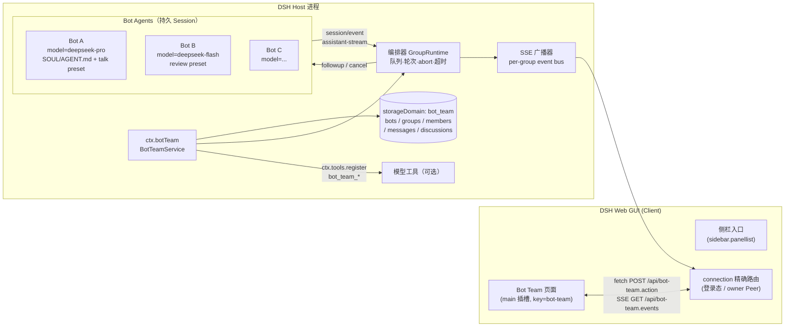

# DSH 多 Agent 群聊插件 `bot_team` — 详细实现方案（v0.1 讨论稿）

> 当前产品原则：所有 Bot 统一为全能力 Bot，不提供只读版或按角色裁剪工具的版本，也不再规划 per-Bot 权限分级。v0.5.7 已取消能力档位，所有 Bot 统一具备文件读写、搜索、联网、命令执行能力，并使用 `workspace-write`。本文中的「讨论型/评审型/执行型」、`allowWorkBots`、read-only guard 等描述为历史设计记录。
>
> 注（v0.8）：包名与 Client module id 已改为 `dsh-bot-team`，文件数据目录改为 `$DSH_HOME/dsh-bot-team/`；文中 `@local/bot-team`、`$DSH_HOME/bot-team` 为历史写法。
>
> 目标：在 DSH Web GUI 里做一个"群聊/话题"能力：一个群可以拉入多个 bot agent，每个 bot 可单独设置模型、SOUL.md / AGENT.md 人格与行为规范；用户可以在群里 @A 派任务、@B 评审 A 的结果、或让 A/B/C 就一个问题讨论。
>
> 本文所有"能做到/不能做到"的结论，都基于本机 DSH `0.2.1-rc.3`（Desktop Profile）的实测与源码调研，证据文件见 `research/runtime.md`、`research/ui.md`、`research/persistence.md` 与文末附录。
>
> 当前阶段只出方案，不改动 profile、不安装插件。

---

## 0. 结论摘要（TL;DR）

1. **产品形态**：插件含 Host 半 + Client 半。Client 在左侧栏 `sidebar.panellist` 增加「Bot Team」入口，点击打开 `main` 区域的一整页群聊工作台（与内置 Plugin Manager 页面同一机制，已验证）。**群不是 session**，是插件自有对象。
2. **每个 Bot = 真实的 DSH Agent**（独立持久 Session），创建时用 `agentOptions: { provider, model, reasoningEffort, maxTokens }` 指定模型；用 `agentPresets.mount()` 挂"能力 preset"；用 agent 作用域的 `systemPrompt.section()` 注入 SOUL.md/AGENT.md 人格；用 `agent.followup()` 驱动、`session/event` 捕获回复、`agent/assistant-stream` 做打字机流式。
3. **群里发生的一切（群、bot 定义、成员、消息、讨论状态）存插件自己的 `storageDomain`**，不往 Session log 里塞自定义事件（DSH 明确禁止第三方插件新增 session event type），也不污染任何模型的对话历史。
4. **@提及 = 确定性路由器**：mention 有序派发 turn；`评审`、`讨论` 是编排器的一等语义（固定轮次状态机），不需要一个"AI 主持人"额外烧 token。
5. **Client ↔ Host 通道**：`ctx.connection.fetch.register()` 注册受登录态保护的 `/api/bot-team.*` 精确路由 —— 写用 `POST` JSON、读用 `GET`、实时用 **SSE**。**不需要 Typert 代码生成器**（该生成器未随 Desktop 安装包分发，是原方案最大风险，已被此路线绕开）。
6. **Bot 的能力分三档 preset**：讨论型（无工具）、评审型（只读文件/搜索/联网）、执行型（可写工作区）。Bot 默认 `approval: never`、禁用 `ask_user_question`（后台 bot 的人类交互会死锁/串到错误 UI）。
7. **分 4 个里程碑**：M0 先用一个最小插件把"页面 + 路由 + SSE + 单 bot 回复 + 重启恢复"的 6 个技术点验证掉，再进入功能开发。
8. 仍待拍板的 8 个产品决策见 **第 15 节**（都有推荐项）。

---

## 1. 需求与产品形态

### 1.1 用户故事（验收口径）

| # | 场景 | 期望行为 |
|---|---|---|
| S1 | 建群/话题 | 创建「群」时可填名称/话题、选择工作目录；可把"Bot 库"里的 bot 拉进群 |
| S2 | 自定义 bot | 每个 bot 独立设置：显示名/头像色、provider+model+reasoning effort、SOUL.md（人格）、AGENT.md（行为规范/技能说明）、能力档位与权限 |
| S3 | 指派任务 | 群里发 `@A 请你完成 X`，A 独自动手（可用工具），完成后把结果贴回群里 |
| S4 | 评审 | 对 A 的某条结果点「请人评审」→ 选 B → B 收到 A 的完整产出+评审要求，回复结论（通过/需修改）与理由；可一键让 A 按意见修改 |
| S5 | 讨论 | 发起「A、B、C 就 X 讨论 2 轮」→ 按顺序各发言，控制台可见轮次进度；可随时停止；结束后可让某成员总结共识/分歧 |
| S6 | 旁观与追溯 | 群消息持久化，重启 DSH 后群、bot 配置、消息都还在；可查看每个 bot 的完整"私聊会话"日志 |
| S7 | 从主会话指挥（加分项） | 在普通 coding session 里对主 agent 说"建一个群，拉 A/B 进来讨论 Y"，主 agent 通过 `bot_team_*` 工具完成 |

### 1.2 范围与非目标

**MVP 范围内**：群/话题、Bot 库+成员配置、单人 @ 派发、多 @ 串行、评审、讨论、停止、流式显示、重启恢复、模型目录下拉、人格文件热更新、token 用量展示。

**明确不做（一期）**：AI 主持人自由讨论、跨进程/多用户、群内语音/图片（可复用 attachments 但排后）、bot 之间自由私聊（只走群路由）、多群共享同一份 bot 记忆、宿主机之外运行 bot（ACP/Codex 等外部后端）。

---

## 2. 技术可行性结论（带证据）

| 能力 | 结论 | 证据 |
|---|---|---|
| 新增一个整页 UI | ✅ 侧栏 `sidebar.panellist` + `main`（keyed，按 panelId 切换），Plugin Manager 就是这样做的 | `client Slots.listSubTree`；`dsh-client-ui-plugin-manager/lib/client.js:4351-4491` |
| Client→Host 新 API（不经代码生成） | ✅ `ctx.connection.fetch.register({path:'/api/...'})`，走 `/api` 登录态/owner-peer 校验；支持流式 Response | `dsh-client-connection/lib/index.js:820-853`（route registry）、`bridge()` 逐块写 `response.body` |
| 实时推送 | ✅ SSE（GET 路由返回 `text/event-stream` ReadableStream），或退化为轮询 | 同上；`session-log-export` 用 exact route 返回流式文件 |
| 新建带自定义模型的 agent | ✅ `ctx.agents.create({ agentOptions:{ provider, model, reasoningEffort, maxTokens }, meta, setup })` | `cordis_inspect_query(host).Service.listService("agents")` → `CreateAgentOptions/AgentOptions` |
| 每 bot 独立人格 | ✅ `setup(agentCtx)` 里注册 agent 作用域 `systemPrompt.section()`，同名可覆盖部署人格；文本函数每次组装都会重算 | `systemPrompt` 服务契约；`dsh-system-prompt/lib/index.js` `deployment:persona-prefix` |
| 每 bot 能力/工具集 | ✅ 注册自定义 `agentPresets`（Cordis 插件清单），创建时 `meta.agentPreset` + `setup` 里 `agentPresets.mount()` | `dsh-api-session-controller/lib/index.js:351-364` 的标准做法 |
| 驱动/观察 bot | ✅ `followup/steer/inject/cancel/whenIdle`；回复看 `session/event` 的 `assistant/message`+`turn/end`；流式看 `agent/assistant-stream` | `dsh-agent/README.md:45-67`；`Event.listEvents` |
| Bot 不出现在左侧会话列表 | ✅ `SessionHeader.origin:'subagent'` 的会话在侧栏被隐藏 | `dsh-client-ui-workspace/lib/client.js:965`；`ui-workspace/README:181` |
| 持久化群/消息 | ✅ `ctx.storageDomain.open(defineDomain({...}))`，per-record KV，写穿、串行、可校验、无迁移 | `dsh-storage-domain` README/lib；调研 `research/persistence.md §1` |
| 往 session log 写自定义事件 | ❌ 不允许（`appendPluginRecord` 仅限 DSH 内部 experimental 包；未知事件必须 `ignorable:true` 而 `Session.append` 设不了） | `dsh-session/README.md:70-76`；`practices.md:21` |
| 复用现成 Agent Teams 服务 | ⚠️ 不建议做核心：`SpawnTeammateRequest` 无 model/preset/persona，一个 root session 一个 Team，名字不可改删 | `Service.listService("agentTeams")`；`experimental-agent-team/README` |
| 新增 Typert `@Remote` 命名空间 | ❌ 不能走官方生成（`dsh-typert-generator` 未随包分发）；手写 contribution 理论可行但脆弱 | `api-remotes/README`；生成器包不存在 |

**由此确定两个关键选型**：
- **不用 session log 承载群状态** → 插件自有 domain（群/成员/消息/讨论）。
- **不用 Typert 生成的 Remote** → 用 Connection 的 exact Fetch route + SSE（这是框架明确支持的"feature package 注册非 JSON 响应"扩展点，鉴权由 `/api` 统一完成）。

---

## 3. 架构总览



### 3.1 组件职责

| 组件 | 职责 |
|---|---|
| **Client 页面** | 群列表 + 消息时间线 + 成员 roster + 输入框；本地 store 管理选中群/草稿/对话框；SSE 订阅增量、断线重连 + 轮询兜底 |
| **连接层** | `/api/bot-team.action`（写）、`/api/bot-team.bootstrap`、`/api/bot-team.messages`、`/api/bot-team.events`（SSE）、`/api/bot-team.file`（人格文件读写） |
| **BotTeamService** | 领域模型的 CRUD、校验、事件总线、生命周期；对 UI 暴露 action dispatch |
| **GroupRuntime（每群一个）** | 每群单写锁 + turn 队列；把"消息/评审/讨论"展开成 bot turn job；保证同一 bot 同时只有一个 turn |
| **BotAgentPool** | 懒创建/恢复 bot agent（`agents.create/resume`），缓存 AgentHandle，命中 `origin:'subagent'` 隐藏；配置变更时重建 agent |
| **PromptBuilder** | 人格段落缓存、群上下文增量拼装、任务模板、token 预算截断 |
| **Domain** | 群、bot 定义、成员关系、消息、讨论/任务记录的持久化 |
| **模型工具** | 可选：让普通 session 的主 agent 通过 `bot_team_*` 指挥群 |

### 3.2 关键决策与备选（讨论点）

| 决策 | 推荐 | 备选与理由 |
|---|---|---|
| 群的载体 | **插件对象 + 独立页面** | 备选：群=真实 session，群消息写 session log。坏处：必须伪造 user 消息、污染模型历史、还需要一个"主持人 agent"收消息；UI 仍要自定义。 |
| Bot 的载体 | **独立 root Agent（`origin:'subagent'` 隐藏）** | 备选：subagent 子 agent（受 `maxActiveSubagents=8`/`maxDepth`/父子消息语义限制，且聊天 bot 的"被委派"系统提示不匹配）；备选：agentTeams（无 per-bot model）。 |
| 群状态存储 | **storageDomain** | 备选：session projection（只能折叠 session 事件，我们的数据没有 session 事件可折）；备选：JSON 文件自管（生命周期/变更通知/校验都要重写）。 |
| UI→Host 写通道 | **exact fetch route** | 备选：Typert 生成 Remote（不可用）、Host commands（会出现在每个会话的 `/` 菜单，语义也不合）、主 session prompt（不确定、慢）。 |
| 多 bot 发言 | **群内串行**（默认） | 备选：并行。串行保证"B 看到 A 的发言"、回放顺序稳定，先做对再提速。 |
| 讨论驱动 | **确定性状态机** | 备选：AI 主持人 agent（多一层不可控 token 与失败点）。 |

---

## 4. 数据模型

全部存一个 domain：`bot_team`，`version: 1`，`layout: 'per-record'`，每类一张表。值为纯 JSON，插件侧用 zod 校验（domain 要求 `ZodType`；`zod` 作为插件依赖随 bundle 安装，DSH 自身也在用同版本 4.x）。

```ts
// ── Bot 库（跨群复用）─────────────────────────────────────────
interface BotProfile {
  botId: string;                 // ulid
  name: string;                  // 显示名，同时是 @ 提及的匹配词（唯一）
  color: string;                 // 头像色（token 之外仅用于头像）
  // 模型
  provider: string;
  model: string;
  reasoningEffort?: string;
  maxTokens?: number;            // 单次输出上限
  // 能力
  capability: 'talk' | 'review' | 'work';   // → 映射到 preset
  // 人格文件（相对 botsDir 的路径；可为空）
  soulFile?: string;             // e.g. "alice/SOUL.md"
  agentFile?: string;            // e.g. "alice/AGENT.md"
  inlinePersona?: string;        // 额外补充文本（UI 表单）
  createdAt: number;
  updatedAt: number;
}

// ── 群 ───────────────────────────────────────────────────────
interface Group {
  groupId: string;
  title: string;
  topic?: string;
  workspaceCwd?: string;         // 执行型 bot 的工作目录；缺省 = 配置默认
  defaultResponderBotId?: string; // 无 @ 时的默认响应者；空 = 不响应
  settings: {
    maxContextMessages: number;  // 每次发给 bot 的历史消息上限
    discussionRounds: number;    // 默认讨论轮数
    allowParallel: boolean;      // 一期内固定 false
  };
  nextSeq: number;               // 消息序号分配（在群记录上 CAS）
  createdAt: number;
  updatedAt: number;
}

// ── 群成员（bot 在某群里的实例，持有独立 session = 独立记忆）──
interface Membership {
  membershipId: string;
  groupId: string;
  botId: string;
  order: number;                 // roster 顺序 / 讨论发言顺序
  sessionId: string;             // bot 的持久 SessionId（'session-<uuid>'）
  overrides?: {                  // 群内覆盖（缺省用 BotProfile）
    provider?: string; model?: string; reasoningEffort?: string;
    capability?: 'talk' | 'review' | 'work';
  };
  enabled: boolean;
  lastSeenSeq: number;           // 该 bot 已读到的群消息序号（增量上下文）
  status: 'idle' | 'running' | 'error';   // 运行态（不持久，加载后重建）
  lastUsage?: { inputTokens: number; outputTokens: number };
}

// ── 消息（群的全部时间线）─────────────────────────────────────
interface ChatMessage {
  messageId: string;
  groupId: string;
  seq: number;                   // 群内单调递增
  author: { type: 'human' } | { type: 'bot'; membershipId: string } | { type: 'system' };
  kind: 'chat' | 'review' | 'discussion' | 'system' | 'task';
  text: string;                  // Markdown
  mentions: string[];            // membershipId 列表（UI 结构化传入，host 校验）
  replyTo?: string;              // messageId
  meta?: {                       // 编排信息
    discussionId?: string; round?: number; reviewOf?: string;
    verdict?: 'pass' | 'changes'; model?: string;
  };
  status: 'pending' | 'streaming' | 'done' | 'error' | 'stopped';
  error?: string;
  usage?: { inputTokens: number; outputTokens: number };
  createdAt: number;
  updatedAt: number;
}

// ── 讨论 ─────────────────────────────────────────────────────
interface Discussion {
  discussionId: string;
  groupId: string;
  topic: string;
  membershipIds: string[];
  rounds: number;
  currentRound: number;
  currentIndex: number;
  summarizeAtEnd: boolean;
  status: 'running' | 'done' | 'stopped' | 'error';
  parentMessageId: string;       // 发起讨论的系统消息
  createdAt: number;
}
```

**表**：`bots`、`groups`、`members`、`messages`、`discussions`。

**顺序与 CAS**：domain 只有"单 domain 写链"，没有 per-record CAS。群内 `nextSeq` 用 `group.update(g => ({...g, nextSeq: g.nextSeq+1}))` 的串行 transform 分配（单进程内安全）；写消息时先取 seq 再 `put`，并在 GroupRuntime 内用每群 Promise 队列串行化"取号+落库"，保证 seq 无洞且顺序与 UI 一致。

**约束**：domain 没有 schema 迁移；`version` 变了会拒绝打开。因此一期把"未来可能要加的字段"设计成可选字段；升级 schema 时写一次性迁移脚本（把老表读成内存、`compatibleVersions` 只读、新 domain `version:2` 重写）。

**M0 实测追加约束**：per-record 的 key 必须匹配 `/^[a-zA-Z0-9_-]+$/`（不能出现 `.`、`:`、`/`）；消息/任务/成员 id 一律用 `msg-000123`、ULID（连字符）这类安全字符，不要用 `:` 或 `.` 拼复合 key。

---

## 5. Bot 运行时映射（核心）

### 5.1 创建/恢复

```js
const presets = ctx.get('agentPresets');           // Host 服务
const preset = await presets.resolve(CAPABILITY_PRESET[capability]); // 'bot-team-review' 等

const handle = await ctx.agents.create({
  sessionId: membership.sessionId,                // 自己生成、持久稳定：'session-' + uuid
  meta: {
    cwd: group.workspaceCwd ?? config.workspaceRoot,
    origin: 'subagent',                           // 侧栏隐藏
    agentPreset: preset.id,                       // 记录在 SessionHeader，便于恢复
    // parentSession: 一期不设（见 §5.7 风险）
  },
  agentOptions: {                                 // ★ 每 bot 独立模型
    provider: effective.provider,
    model: effective.model,
    reasoningEffort: effective.reasoningEffort,
    maxTokens: effective.maxTokens,
  },
  setup: async (agentCtx, agent) => {
    await presets.mount(agentCtx, preset.id);     // ★ 能力（工具集）
    installBotPrompt(agentCtx, membershipId);     // ★ 人格/上下文（见 5.3）
    ctx.approval.setPolicy(agent, 'never');       // ★ 后台 bot 不弹审批
    agentCtx.tools.restrict({ deny: BOT_TEAM_TOOL_NAMES }); // bot 不可反向指挥群
  },
});
pool.set(membershipId, { handle, configFingerprint });
```

- **懒加载**：插件启动只从 domain 恢复数据，不创建 agent；第一次被 @ 或打开群详情时才 create/resume。
- **恢复**：进程重启后 `ctx.agents.resume({ resumeSessionId, agentOptions, setup })`，`setup` 会重放人格/工具/审批策略。**注意（M0 实测 P2）**：resume **不会**继承 session 里记录的 provider/model，必须把每个 bot 的模型路由持久化并每次 resume 重新传入 `agentOptions`（否则第一轮就报 `agent has no provider/model`）。`session-persistence-jsonl` 已在 base 层挂载，Session 持久化直接可用；崩溃中断的 turn 会由 resume 自动补 synthetic closer。
- **喂消息（M0 实测 P1）**：`agent.followup(input)` 会把 `input` 原样放进 durable inbox，因此必须是**完整 UserMessage**：`{ role:'user', id: randomUUID(), content:[...], source:{kind:'user'} }`。只传 `{content, source}` 会写出缺 `id`/`role` 的坏日志（LLM 400/422 + session 无法重新打开）。
- **配置变更**：改模型/人格/能力档 → `handle.dispose()` 后按新配置重建 agent（旧 session 保留，历史仍在）；只想换模型也可用 `agent/request` 瀑布动态 pin，但重建更简单可靠。

### 5.2 模型

- 创建时 `agentOptions` 是**唯一**的创建期模型入口（`AgentOptions = {provider?, model?, reasoningEffort?, maxTokens?}`）。
- 运行期换模型：在 `setup` 里注册 `agentCtx.on('agent/request', async (payload, next) => ({ ...(await next()), provider, model, reasoningEffort }))`，可做到不重建。
- UI 下拉数据：客户端直接调已有的 `ctx.remote.session.modelCatalog()`（`sessionController` 的 `@Remote('modelCatalog')`，返回 `{default, routableProviders, groups:[{id,name,models:[{id,name,reasoning:{efforts,defaultEffort}}]}]}`）。host 端在写 action 时用 `ctx.llm.resolveModelInfo(provider, model)` 校验。
- preset **不能** pin 模型（`PresetDefinition` 没有 model 字段）——模型永远在 agent 创建参数/request 拦截里给。

### 5.3 人格：SOUL.md / AGENT.md

> DSH 原生只有 workspace 级 `AGENTS.md`（`@deepseek-ai/dsh-agent-instructions`，无 watcher、按 touch/resume 刷新），**没有 SOUL.md，也没有 per-agent 指令文件配置**。所以这是插件自己要做的能力。

文件约定（`botsDir` 默认 `$DSH_HOME/bot-team/bots/`，也可以改为工作区内 `.bot-team/bots/` 方便随仓库提交）：

```
<botsDir>/<botId>/SOUL.md     # 人格、语气、价值观、角色设定
<botsDir>/<botId>/AGENT.md    # 行为规范、工作流程、技能说明、输出格式
```

注入方式（`setup` 内）：

```js
let personaText = '';           // 闭包缓存；每次 turn 前刷新
agentCtx.systemPrompt.section({
  name: 'deployment:persona-prefix',  // ★ 与部署人格同名 → 覆盖掉 "You are a coding agent..."
  order: 0,
  text: () => personaText,            // 同步函数，每次组装重新调用
});
```

- **热更新**：每轮 `followup` 前异步读两个文件（带 mtime 缓存），变化则更新 `personaText` 闭包变量。下一次 step 组装自动生效，**无需重启/重建 agent**；代价是 prompt 前缀变化会让该 bot 的 KV cache 失效一次。
- **群上下文**另用 `agentCtx.systemPrompt.context({ name:'bot-team:group', order: 600, text: () => dynamicGroupContext })` 注入"群名/话题/成员名单/你在群里的角色/当前轮次"，同样走闭包刷新。
- 人格文本结构（PromptBuilder 模板）：

> **M0 实测 P4**：验证人格是否生效，要看**真实请求后 durable session log 里的 `system/message`**（M0 已证明同名 section 覆盖成功：日志里部署人格消失、自定义标记出现）；不要在 `setup()` 里用 `systemPrompt.assemble()` 断言——setup 阶段 assemble 看到的仍是覆盖前的人格，会误判。

```markdown
你是「{{name}}」，群聊「{{groupTitle}}」的成员之一。

## 身份与人格（SOUL.md）
{{soul}}

## 工作规范与技能（AGENT.md）
{{agentsMd}}

## 群聊行为准则
- 你在群里说的话会直接展示给用户和其他成员；只输出发言本身，不要解释"我准备做什么"。
- 被 @ 指派任务时：直接完成任务，最后用简明结论 + 关键产出回复。
- 被要求评审时：第一行给结论（`结论：通过` 或 `结论：需修改`），再给理由与修改建议。
- 不要假装调用过工具；不确定时说明不确定。
```

### 5.4 能力 preset（三档）

通过 bundle patch 插入 `@deepseek-ai/dsh-agent-preset` 行（Cordis 插件清单），**不挂 `@deepseek-ai/dsh-persona`**（人格由 5.3 覆盖，避免两处身份冲突）：

| preset id | 用途 | 工具 | 说明 |
|---|---|---|---|
| `bot-team-talk` | 纯讨论/头脑风暴 | web_search/web_fetch（可选关闭） | 最便宜，不碰文件系统 |
| `bot-team-review` | 评审代码/方案 | `read`/`glob`/`grep` + web | 只读；由 sandbox 默认 read-only 兜底 |
| `bot-team-work` | 真正干活 | `bash`/`read`/`write`/`edit`/`glob`/`grep`/`jobs`/`web` + compaction | 需用户显式开启（`allowWorkBots`），默认 workspace-write 沙箱 |

preset 通过 `agentPresets.register()`（运行期）或 bundle patch（声明式）注册；推荐 **bundle patch 声明式**，`agentPresets.mount(agentCtx, id)` 挂载即可，升级/调试都简单。preset 会出现在 DSH 的 agent preset 选择器里——这是预期副作用，可在 `name/description` 里标注 "Bot Team 用"。

### 5.5 工具、审批、权限

- **工具**：由 preset 决定；`capability` 三档即三种工具面。
- **审批**：`ctx.approval.setPolicy(botAgent, 'never')`。原因：后台 bot turn 没有可靠的人类审批 UI（approval 的 ask 属于 session 级 answerer，可能在用户当前打开的另一个会话里弹，或 fail-closed 直接拒绝）；`ask_user_question` 也只允许 root agent，bot 若真发起会报错。因此 **bot 必须自带沙箱边界**：讨论/评审默认 read-only；执行型默认 workspace-write，且需要用户显式解锁。
- **结果反馈**：被沙箱/权限拒绝时，把原因作为系统消息贴回群（"B 的工具调用被沙箱拒绝：…"），状态标 `error`，可重试。
- **`ctx.tools.restrict({deny: BOT_TEAM_TOOL_NAMES})`**：bot 不能反向调用 `bot_team_*` 造成递归。
- **M0 实测 P5（必须处理）**：本 profile 的 `tool-agent-team` 是 **Host 平面**行，runtime root 的 bot 会自动获得 Team Lead 身份（runtime-context 里出现 "You are the Team Lead"）与 `spawn_teammate/list_agents/send_message` 等工具。正式插件在 bot 的 `setup` 里除了 deny `bot_team_*`，还要 deny 这套 team 工具；如不希望出现 Team 身份文案，再叠加 `systemPrompt.suppressRuntimeContext()`（会牺牲部分 runtime context，按需取舍）。

### 5.6 bot 的"记忆"

- 每个 `(群, bot)` 的成员有**独立 Session**：它自己的历次回答、工具调用都在里面；跨群不共享（一期）。
- 群共享上下文不依赖 bot 记忆，而是每轮由 PromptBuilder 显式注入"增量消息"（见 §7），所以新加的 bot 也能立刻参与。
- 群/Roster/人格等管理数据不进 bot 的对话历史（零 token 成本）。
- 长会话：能力 preset 里挂 `compaction-basic`，bot 自己的 session 超长时自动压缩；UI 提供「清空该 bot 的记忆」（换新 sessionId，保留成员关系）。

### 5.7 Bot session 的可见性（风险点，M0 验证）

- 设 `meta.origin:'subagent'` 后，左侧会话列表会隐藏该 session（已核实 client 代码）。
- **未设置 `parentSession`**：`subagentAddress()` 解析不出地址，某些"按 subagent 地址投递/归档"的客户端操作会拒绝（`session/agent-busy`、archive 规则）。我们不用这些操作，只在自己页面里展示，风险可控。
- 备选方案（若 M0 发现异常）：每群创建一个"锚点 session"（root，bots 的 `parentSession` 指向它）；锚点自身可在侧栏隐藏/归档，或将群页面注册成锚点会话的自定义视图。**M0 必须先验证这一点。**

---

## 6. 编排语义

### 6.1 路由规则（发一条群消息之后发生什么）

```
用户发送消息 M（含结构化 mentions[]）
├─ 1. 落库：分配 seq，写 messages，SSE 广播 message.added
├─ 2. 解析接收者：
│    ├─ mentions 非空 → 按 UI 中 mention 出现顺序，取其中 enabled 的 bot 成员
│    └─ mentions 为空 → defaultResponderBotId（可配 none）
├─ 3. 若为空：仅存档，不产生任何 turn（@all 一期不支持，用「发起讨论」替代）
└─ 4. 对每个接收者依次入队 TurnJob（同一群串行；同一 bot 天然互斥）
     ├─ 刷新该 bot 的人格缓存（可能变）
     ├─ 组装 Prompt（群上下文增量 + 本条消息 + 任务模板）→ agent.followup()
     ├─ 订阅 session/event：assistant/message 增量 → SSE message.delta
     ├─ turn/end(completed) → 取该 turn 最后一条 assistant 文本 → message.final
     └─ turn/end(error/aborted/max-tokens) → message.error + 原因
```

**多 @ 语义（已拍板：并行）**：`@A @B` 时 A、B **同时**开跑，各自看到的是"触发消息之前"的上下文（看不到对方对这条消息的回复）。实现要求：
- 派发时先为每个接收者创建一条 `status:'pending'` 的占位消息（预分配 seq，时间线顺序 = mention 顺序），SSE 先广播 `message.added`，随后各 turn 用 `message.delta` 更新自己的占位消息；
- 群级并行上限 `maxParallelTurns`（默认 3），每个 bot 仍有单 turn 互斥；
- **评审/讨论不走并行**：它们依赖"已有消息"，始终串行（评审要读原文，讨论要按轮次顺序）；
- 未完成的并行 turn 若被停止，占位消息标 `stopped`，已产出的流式内容保留。

### 6.2 评审（review）

UI：任意 bot/人类消息右侧「请人评审」→ 选评审者 →（可选）评审要求。

Host：

1. 写一条 `kind:'review'` 的系统消息："@B 请评审 #42 @A 的产出"，带 `replyTo`。
2. 给 B 的 prompt 里带**完整原文**（不是增量），要求固定格式：

```markdown
[待评审内容] 作者：A（model）  原消息 #42
---
{{target.text}}
---
[评审要求] ...
[输出格式]
结论：通过 | 需修改
理由：...
建议修改：
- ...
```

3. 解析回复第一行 `结论：(通过|需修改)` → 存 `meta.verdict`，UI 显示绿/黄徽标。
4. 「让 A 按评审修改」按钮：写一条 review 消息，`replyTo=评审消息`，路由给 A，prompt 自带评审意见全文。

### 6.3 讨论（discussion）

发起：选成员（默认全群）、轮数（1-5）、话题、是否最后总结。

```ts
// 确定性状态机（GroupRuntime 内）
for (round = 1..rounds)
  for (member of memberIds in roster order)
    prompt = discussion_prompt(topic, round, rounds, 本群本轮已有发言, 上一轮摘要)
    await runBotTurn(member, prompt, { kind:'discussion', discussionId, round })
    // 广播 discussion.updated 进度
if (summarizeAtEnd) 让第一个成员输出「共识/分歧/待决问题」
```

- 每轮 prompt 要求"简明（≤ N 字），不重复他人观点，可明确表示同意/反驳某位成员"。
- 讨论期间用户仍可正常 @ 插话；插话排在同一群队列里、按到达顺序执行。
- 「停止」= `group.stop()`：中断当前 bot turn（`agent.cancel({kind:'user'}, {keepInbox:false})`），清空该群 pending 队列，讨论标 `stopped`，已产出的消息保留。
- 限制：一个群同时只允许一个讨论；`maxTurnsPerDiscussion`（默认 30）兜底防跑飞。

### 6.4 任务（v0.5，可选）

> **v0.5 任务板已完成**：见 [任务板验证报告](v0.5-任务板-验证报告.md)；**v0.5.1 任务模型工具 + 依赖/优先级已完成**：见 [v0.5.1 验证报告](v0.5.1-任务模型工具-验证报告.md)；**v0.5.2 队列/一键派发已完成**：见 [v0.5.2 验证报告](v0.5.2-任务队列与一键派发-验证报告.md)。tasks 表 + 状态机（pending→in_progress→delivered→accepted/changes_requested→返工）+ Engine 派发/交付/评审 hook + 右栏任务卡片 + 消息任务标记；冒烟 smoke-v7 覆盖两条链路。

在消息语义之上加一个轻量任务板（复用 agent-team 的 CAS 思路）：

```ts
interface Task { taskId; groupId; title; description; acceptance?;
  assigneeMembershipId; status:'pending'|'in_progress'|'delivered'|'accepted'|'changes_requested';
  deliverableMessageId?; reviewerMembershipId?; revision: number; ... }
```

- 「指派任务」对话框 → 生成任务 + 给 A 的 prompt（含验收标准）→ A 回复自动挂到 deliverable。
- 评审 = 任务状态流转；"需修改"回到 `in_progress` 并把意见注入 A。
- UI：右栏任务卡片；@ 提及仍可用（不强制走任务）。

### 6.5 并发、超时与停止

| 机制 | 实现 |
|---|---|
| 群级串行 | 每群一个 Promise 队列（内存）；跨群并行 |
| 单 bot 互斥 | 一个 membership 同时最多一个 in-flight turn；重复 mention 排队 |
| 超时 | 每 turn 计时器（默认 5 min）到点 `agent.cancel()` → 标 error + "超时"系统消息；可重试 |
| 用户停止 | 页头/按钮 → 取消当前 turn + 清队列；保留已有输出 |
| 插件卸载 | `effect` 清理：abort 所有 turn、dispose 所有 AgentHandle、关闭 SSE、`domain.close()` |
| 崩溃恢复 | 加载时把 `pending/streaming` 消息标为 `interrupted`；bot session 由 resume 修复 |
| 防止失控 | `maxTurnsPerMention`（如 3，指一条消息最多触发的 bot turn 数）、`maxTokens`、月度/群级用量展示 |

---

## 7. 上下文与提示词设计

### 7.1 增量记忆

每个成员记录 `lastSeenSeq`。一次 turn 的上下文 = `messages[lastSeenSeq+1 .. now]`，按 `maxContextMessages` 截断（超长时保留最新，并在头部加一行"更早的 N 条消息已省略"；v0.5 用滚动摘要替代省略）。

好处：token 不随群历史线性暴涨；每个 bot 只消费"自己没看过的部分"，且能看到其他 bot 的发言（共享群上下文）。代价：无法回放很久之前的细节——通过引用消息（`replyTo` 带原文）和任务交付物补齐。

### 7.2 一次 turn 的消息模板

```markdown
<group>
群：{{title}}（话题：{{topic}}）
成员：{{roster with capability/model}}
你是：{{name}}（{{roleHint}}）
</group>

<new-messages since="seq={{lastSeen}}">
[#41] 用户: ...
[#42] 用户: @alice 请给出方案；@bob 稍后评审
</new-messages>

<your-turn>
现在轮到你（{{name}}）回应。
{{#if mentionsMe}}上一条消息 @ 了你：{{#each myMentions}}{{this}}{{/each}}{{/if}}
{{#if review}}你被要求评审 #{{targetSeq}}（全文见下）…{{/if}}
{{#if discussion}}讨论「{{topic}}」第 {{round}}/{{rounds}} 轮，请给出你的观点。{{/if}}
</your-turn>

<rules>
- 只输出发到群里的内容，Markdown 格式，不要输出分析过程或"我在执行"之类的话。
- 结论先行；需要工具就调用；完成后给出结果摘要。
</rules>
```

### 7.3 Token 预算参数（可配）

| 参数 | 默认 | 作用 |
|---|---|---|
| `maxContextMessages` | 40 | 单次注入的历史消息条数上限 |
| `maxContextChars` | 24k | 字符硬上限（先截历史再截长消息） |
| bot `maxTokens` | 4000 | 单次输出上限 |
| `turnTimeoutMs` | 300000 | 单 turn 超时 |
| `maxTurnsPerDiscussion` | 30 | 讨论总 turn 上限 |

### 7.4 人格/上下文的热更新路径

```
修改 SOUL.md/AGENT.md（UI 内编辑器 或 外部编辑器）
  → 下一轮 followup 前 read 文件（mtime+size 命中缓存则跳过）
  → personaText 闭包更新
  → 该 bot 下一次 step 组装时生效（KV cache 失效一次，可接受）
```

---

## 8. Host ↔ Client 通信

### 8.1 为什么不用 Typert Remote

官方 `@Remote` 方法对 Client 的暴露依赖**构建期生成的** `./remote` 产物（`createTypertRemoteInfo` + 严格 codec），而 `@deepseek-ai/dsh-typert-generator` **不随 Desktop 安装包分发**，且 `api-remotes` 固定了已选命名空间集合。第三方纯 JS 插件无法可靠地新增命名空间（手写 contribution 需伪造严格 codec，框架升级易碎）。

### 8.2 采用的通道：Connection exact Fetch routes

`ctx.connection.fetch.register(route)` 是框架公开扩展点（Session 日志下载、文件上传、deliverables 都在用），具备：

- **鉴权**：走 `/api` 的浏览器 Cookie（`HttpOnly; SameSite=Strict`）+ Host/Origin 防 CSRF 栅栏；route 处理器只接受 owner Peer。
- **流式**：`bridge()` 逐块写 `response.body`，SSE 可行。
- **零代码生成**：客户端 `fetch()` / `EventSource` 直接用。
- **生命周期**：注册即 `ctx.effect`，插件卸载自动摘除。

路由清单（`endpointFromPath` 允许 `[A-Za-z0-9_$.-]`，所以路径用一个 segment）：

| Route | Method | 用途 | 返回 |
|---|---|---|---|
| `/api/bot-team.bootstrap` | GET | 启动数据：bots、groups、members、默认模型目录、配置 | JSON |
| `/api/bot-team.messages?groupId=&beforeSeq=&limit=` | GET | 历史消息分页 | JSON |
| `/api/bot-team.events?groupId=&afterSeq=` | GET | **SSE**：增量帧 | `text/event-stream` |
| `/api/bot-team.action` | POST | 所有写操作（见 8.3） | JSON `{ok,result}` / `{ok:false,error}` |
| `/api/bot-team.file?botId=&kind=soul\|agent` | GET / PUT | 人格文件读/**写**（路径白名单，防穿越） | `text/plain` / JSON |

客户端订阅示例：

```js
const es = new EventSource('/api/bot-team.events?groupId=' + groupId);
es.addEventListener('message.added', e => apply(JSON.parse(e.data)));
es.addEventListener('message.delta', e => appendDelta(JSON.parse(e.data)));
es.addEventListener('message.final', e => finalize(JSON.parse(e.data)));
es.addEventListener('member.status', e => setStatus(JSON.parse(e.data)));
es.onerror = () => { es.close(); setTimeout(reconnect, 1500); /* 同时轮询兜底 */ };
```

SSE 帧类型：

```ts
type Frame =
  | { type:'hello'; groupId; seq }
  | { type:'message.added'; message: ChatMessage }
  | { type:'message.delta'; messageId; text; attempt }   // 打字机增量
  | { type:'message.final'; message: ChatMessage }
  | { type:'member.status'; membershipId; status; error? }
  | { type:'discussion.updated'; discussion: Discussion }
  | { type:'group.updated'; group: Group }
  | { type:'error'; scope:'turn'|'route'|'bot'; message; detail? }
  | { type:'heartbeat'; t:number };
```

Host SSE 骨架：

```js
ctx.connection.fetch.register({
  path: '/api/bot-team.events', methods: ['GET'], requestBody: 'buffered',
  fetch: (request) => {
    const groupId = new URL(request.url).searchParams.get('groupId');
    const enc = new TextEncoder();
    const stream = new ReadableStream({
      start(controller) {
        const write = (f) => controller.enqueue(enc.encode(`event: ${f.type}\ndata: ${JSON.stringify(f)}\n\n`));
        write({ type:'hello', groupId, seq: bus.lastSeq(groupId) });
        const off = bus.subscribe(groupId, write);
        const hb = setInterval(() => controller.enqueue(enc.encode(': ping\n\n')), 15000);
        request.signal.addEventListener('abort', () => { off(); clearInterval(hb); try { controller.close(); } catch {} });
      },
    });
    return Promise.resolve(new Response(stream, {
      headers: { 'content-type': 'text/event-stream; charset=utf-8', 'cache-control': 'no-store' },
    }));
  },
});
```

### 8.3 写接口（`POST /api/bot-team.action`）

```ts
type Action =
  // 群
  | { action:'group.create'; payload:{ title; topic?; workspaceCwd?; memberBotIds?: string[] } }
  | { action:'group.update'; payload:{ groupId; title?; topic?; defaultResponderBotId?; settings? } }
  | { action:'group.delete'; payload:{ groupId } }         // 软删：归档 bot sessions 保留审计
  // bot 库
  | { action:'bot.upsert';  payload:{ bot?: BotProfile; botId?: string } }
  | { action:'bot.delete';  payload:{ botId } }
  // 成员
  | { action:'member.add';  payload:{ groupId; botId; order? } }
  | { action:'member.update'; payload:{ membershipId; overrides?; enabled?; order? } }
  | { action:'member.remove'; payload:{ membershipId } }
  | { action:'member.resetMemory'; payload:{ membershipId } }   // 换新 sessionId
  // 消息与编排
  | { action:'message.post'; payload:{ groupId; text; mentions?: string[]; replyTo? } }
  | { action:'message.stop'; payload:{ groupId } }              // 停止当前 turn + 清队列
  | { action:'message.retry'; payload:{ messageId } }
  | { action:'review.request'; payload:{ groupId; targetMessageId; reviewerMembershipId; instructions? } }
  | { action:'discussion.start'; payload:{ groupId; topic; membershipIds?; rounds?; summarizeAtEnd? } }
  | { action:'discussion.stop'; payload:{ discussionId } }
  // 人格文件
  | { action:'persona.write'; payload:{ botId; kind:'soul'|'agent'; text } };
```

服务端统一：解析/白名单校验 → 领域写 → 触发编排 → 返回。所有请求体上限、群数量上限、成员数量上限、文本长度上限在入口校验。

### 8.4 回退方案（万一 M0 发现 exact route 不可用）

1. **轮询**：去掉 SSE，页面 2s 拉 `messages?afterSeq=`（功能可用，体验略差）。
2. **Host commands 通道**：注册 `/` 命令，客户端用现有 `ctx.remote.commands.execute(sessionId, line, [])` 执行（已验证该 RPC 存在），缺点：命令出现在所有会话的 `/` 菜单。
3. **在 DSH 源码 checkout 里构建** Typert 产物（`@deepseek-ai/dsh-typert-generator`），走官方 Remote，但需要源码环境且升级需重生成。

---

## 9. UI / UX 设计

### 9.1 页面注册（Client 半）

```js
window.__ModuleLoader__.load({ id: '@local/bot-team', factory(require) {
  const React = require('react');
  return {
    inject: ['slots', 'locale', 'remote'],
    apply(ctx) {
      const NS = 'bot-team';
      ctx.effect(() => ctx.locale.register(NS, { zh, en }), 'bot-team locale');
      // 整页
      ctx.slots.inject('main', () => ctx.slots.register(
        { name:'main', key:'bot-team', locale:NS }, BotTeamPage));
      // 侧栏入口（点击自动 selectPanel）
      ctx.slots.inject('sidebar.panellist', () => ctx.slots.register(
        { name:'sidebar.panellist', id:'bot-team', order: 40, label:()=>ctx.locale.bind(NS)('panel.title'), locale:NS },
        BotTeamIcon));
      // 对话框层
      ctx.slots.inject('shell.overlay', () => ctx.slots.register(
        { name:'shell.overlay', id:'bot-team-dialogs', order: 50, locale:NS }, DialogHost));
    },
  };
}});
```

### 9.2 页面布局（三栏）

```
┌──────────────────────────────────────────────────────────────────────────────┐
│ Bot Team   [群名 ▾]   话题：…                    ● 2 个 bot 运行中  [停止] [⚙] │
├───────────────┬──────────────────────────────────────────────┬───────────────┤
│ 群/话题        │  消息时间线                                   │ 成员 / 讨论   │
│ + 新建群       │  ┌────────────────────────────────────────┐  │ ● Alice       │
│ ─────────     │  │ 🤖 Alice   deepseek-pro   10:21        │  │   pro · 讨论   │
│ ▸ 产品评审     │  │ ## 方案…（Markdown 渲染）              │  │ ● Bob         │
│ ▸ 架构讨论     │  │ [复制][回复][请人评审][让TA修改]        │  │   flash · 评审 │
│ ▸ 竞品调研     │  └────────────────────────────────────────┘  │ + 添加成员     │
│               │  ┌────────────────────────────────────────┐  │ ─────────     │
│               │  │ 🟢 Bob   deepseek-flash   10:24        │  │ 讨论进度       │
│               │  │ 结论：需修改 …                          │  │ 第 1/2 轮      │
│               │  └────────────────────────────────────────┘  │ Alice 发言中…  │
│               │  ┌────────────────────────────────────────┐  │ [停止讨论]     │
│               │  │ 系统：Bob 的工具调用被沙箱拒绝…          │  │ ─────────     │
│               │  └────────────────────────────────────────┘  │ 本群用量 12.4k │
├───────────────┴──────────────────────────────────────────────┴───────────────┤
│ [@] 输入消息…  @ 选择成员   [发起讨论] [发送 →]                                │
└──────────────────────────────────────────────────────────────────────────────┘
```

### 9.3 交互细节

- **@ 选择**：输入 `@` 弹出成员选择器（键盘可导航）；插入规则：名称唯一（重名时自动改名/提示）；提交时同时发送**结构化 mentions**（不依赖文本解析）。host 侧对模型工具/异常输入再做一次 `@displayName` 最长匹配解析。
- **消息操作**：复制 / 回复（引用）/ 请人评审 / 让作者修改 / 停止（该 bot 正在跑时）/ 查看该 bot 的私聊/重试。
- **评审请求对话框**：选评审者 + 自定义要求（预置"代码正确性/方案风险/需求覆盖"）。
- **讨论对话框**：话题（默认当前输入）、成员多选、轮数、是否总结；发起后时间线插入系统卡片，右栏显示进度。
- **成员编辑对话框**（重点）：  
  - 基本信息：显示名、头像色  
  - 模型：provider → model → reasoning effort（来自 `modelCatalog`），maxTokens  
  - 人格：SOUL.md 与 AGENT.md 两个多行编辑器（带"保存到文件"、行数、字符数、预览最终 system prompt 的按钮）  
  - 能力：讨论 / 评审（只读）/ 执行（需二次确认，提示"可读写工作目录"）  
  - 危险操作：清空该成员记忆（换 session）
- **流式显示**：`message.delta` 追加到气泡（含闪烁光标）；断线重连后按 `messageId` 去重、按 `seq` 排序；`final` 覆盖。
- **Markdown 渲染**：一期实现轻量渲染（标题/列表/粗体/行内代码/围栏代码块/链接），不引入第三方库（避免模块表外部依赖问题）；渲染异常一律降级为纯文本。
- **空状态**：无群时展示"新建群"引导 + 三个场景模板（产品评审 / 技术方案讨论 / 代码 Review）。
- **i18n**：`ctx.locale.register` 提供 zh/en 字典，所有 slot 注册带 `locale`；bundle 的 `locale/*.json` 提供插件管理页标题/描述。
- **主题**：只用 `--dsw-alias-*` token；头像颜色走独立 palette；插件 CSS 用一次性 `<style data-plugin-css>` 注入并在卸载时移除。

### 9.4 可选增强（二期）

- `conversation.session.header.actions`：在普通会话头部加"打开 Bot Team"按钮。
- 消息里 @bot 时，若 bot 会话存在，可跳转查看其原生对话（`ctx.uiWorkspace.openSession`）。
- 群聊内容导出 Markdown。

---

## 10. 插件打包、安装与配置

### 10.1 包结构

```
bot_team/                          # 工作区里的 bundle 包目录
├── package.json                   # dsh.bundle.patch + dsh.client
├── cordis.patch.yml               # 插入 bot-team 行 + 3 个 preset 行
├── index.js                       # Host 半入口（ESM，可 import 本地 host/*.js）
├── host/
│   ├── service.js                 # BotTeamService（domain/编排/生命周期）
│   ├── domain.js                  # defineDomain + zod schemas
│   ├── runtime.js                 # GroupRuntime（队列/turn/abort）
│   ├── bot-pool.js                # agents.create/resume/dispose、preset mount
│   ├── prompt.js                  # 人格缓存、上下文拼装、模板
│   ├── routes.js                  # fetch routes + SSE + action dispatch
│   ├── tools.js                   # bot_team_* 模型工具
│   └── config.js                  # 配置默认值与校验
├── client.js                      # Client 半（单文件，ModuleLoader 工厂）
├── locale/en.json, locale/zh.json # 插件管理页元数据
├── icon.svg
└── README.md
```

`package.json`：

```json
{
  "name": "@local/bot-team",
  "version": "0.1.0",
  "private": true,
  "type": "module",
  "exports": {
    ".": "./index.js",
    "./client": "./client.js",
    "./locale/*.json": "./locale/*.json",
    "./icon": "./icon.svg"
  },
  "files": ["index.js", "host/*.js", "client.js", "cordis.patch.yml", "locale/*.json", "icon.svg"],
  "dependencies": { "zod": "4.4.3" },
  "dsh": {
    "bundle": { "patch": "./cordis.patch.yml" },
    "client": { "platform": "web", "immediately": true, "inject": ["@deepseek-ai/dsh-client-ui-layout", "@deepseek-ai/dsh-client-ui-sidebar"] }
  }
}
```

`cordis.patch.yml`：

```yaml
- insert:
    - id: bot-team
      name: '@local/bot-team'
      config:
        workspaceRoot: ''
        botsDir: ''
        maxGroups: 20
        maxMembersPerGroup: 8
        maxContextMessages: 40
        turnTimeoutMs: 300000
        maxTurnsPerDiscussion: 30
        enableModelTools: true
        allowWorkBots: false

    - id: preset-bot-team-talk
      name: '@deepseek-ai/dsh-agent-preset'
      config: { id: bot-team-talk, name: 'Bot Team · 讨论', order: 20, plugins: [ /* web tools */ ] }
    - id: preset-bot-team-review
      name: '@deepseek-ai/dsh-agent-preset'
      config: { id: bot-team-review, name: 'Bot Team · 评审', order: 21, plugins: [ /* read/glob/grep/web */ ] }
    - id: preset-bot-team-work
      name: '@deepseek-ai/dsh-agent-preset'
      config: { id: bot-team-work, name: 'Bot Team · 执行', order: 22, plugins: [ /* bash/fs/web/compaction */ ] }
```

### 10.2 安装与验证

1. 在 workspace 里开发完成后：`plugin_manager action=install_bundle target=<绝对路径>`（需要审批）。
2. 读安装结果的 `application`（`applied` 即生效）与 `warnings`；用 `cordis_inspect_query` 确认 `bot-team` 行存在且激活。
3. 刷新 GUI → 左侧出现 Bot Team 图标 → 打开页面 → 用 M0 清单逐项验证（附录 D）。
4. 注意：profile 级安装对所有会话生效；Client 半代码更新需要重装 bundle 或重启（除非 `pnpm run dev:web` 的 HMR 在跑）。

### 10.3 配置项（`config`）

| 字段 | 默认 | 说明 |
|---|---|---|
| `workspaceRoot` | 空 = `process.cwd()` | bot 工作目录的根 |
| `botsDir` | 空 = `$DSH_HOME/bot-team/bots` | 人格文件目录；也可设到工作区 `.bot-team/bots` |
| `maxGroups` / `maxMembersPerGroup` | 20 / 8 | 上限防滥用 |
| `maxContextMessages` | 40 | 上下文条数 |
| `turnTimeoutMs` | 300000 | turn 超时 |
| `maxTurnsPerDiscussion` | 30 | 讨论上限 |
| `enableModelTools` | true | 是否向普通会话暴露 `bot_team_*` 工具 |
| `allowWorkBots` | false | 是否允许"执行型"能力（可写工作区） |

---

## 11. 安全、成本与限额

**安全**

- 所有路由都在 `/api` 的登录态 + Host/Origin 栅栏内；空 `path` 参数白名单 + 目录穿越校验（人格文件只能落在 `botsDir` 内）。
- Bot 是真实 agent：能力档位决定工具面；执行型默认关闭；会话 cwd 限定在群工作目录（sandbox workspace-write 的边界就是 session cwd）。
- Bot `approval: never` + 禁用 `ask_user_question`，避免后台 turn 卡死；沙箱拒绝会在群里显式报错。
- `bot_team_*` 工具从 bot agent 的工具面中移除，防止自我指挥递归。
- 群数据只在本机 profile domain 内，纯 JSONL/JSON 落盘，无外发。

**成本**

- 每个 bot turn 的花费 = 人格/上下文 + 回复；每群显示累计 token。
- 三重上限：单条消息最多触发 `maxTurnsPerMention` 个 turn；讨论 `maxTurnsPerDiscussion`；单 turn `maxTokens` + 超时。
- "讨论"N bot × R 轮的成本在发起对话框中预估显示（按近 10 条平均 token 估）。

**性能**

- SSE per group；页面只订阅当前群 + 群列表。
- 消息分页（默认 50 条/页），滚动加载。
- domain 读取全内存；群消息量大时按 seq 游标分页，不做全量回放。

---

## 12. 故障、恢复与可观测性

| 场景 | 处理 |
|---|---|
| provider/model 不可用 | 写系统消息 + error 状态 + 重试按钮；成员卡片标红，提示重选模型 |
| bot turn 超时/中断 | `agent.cancel()`，消息标 `stopped/error`，保留已流式内容 |
| 插件卸载/HMR | abort 全部 in-flight、dispose 全部 AgentHandle、关 SSE、`domain.close()`；下次加载懒恢复 |
| 进程崩溃 | 加载时把 `pending/streaming` 标 `interrupted`；resume 时 DSH 自动补 closer；UI 提供重试 |
| 群删除 | 软删群记录；bot sessions 保留（可审计/可恢复），purge 走显式操作 |
| 模型目录变化 | 成员模型失效时 UI 警告；host 在创建/恢复时报错并落系统消息 |
| 双开页面 | 每个页面独立 SSE；写操作串行在 host，无需前端互斥 |
| 日志 | Host 侧 `ctx.logger` 分级日志（turn 开始/结束/错误/耗时）；错误进 domain 的 `system` 消息便于用户看到 |

---

## 13. 实施计划

> 工作量为单人估算，含自测；安装/验证受审批流程影响。

### M0 技术验证 spike（0.5–1 天）— 先证明 6 件事

> **进展：✅ M0 已完成（全绿 22/22）**。spike 已落地并跑通（`spike/bot-team-spike/`，结果见 [M0-验证报告](M0-验证报告.md)）：
> 路由/SSE/401/domain 落盘/模型/人格/同进程恢复/整机重启恢复/页面渲染全部实证；spike 已从 profile 卸载、临时 session 已清理。
> 实测发现 5 个必须遵守的坑（followup 传完整 UserMessage、resume 必须复传模型、domain key 字符集、persona 断言位置、
> runtime-root bot 继承 Team 身份/工具），已回写到本文 §4/§5/§6/§14。

1. 最小 bundle 安装后：侧栏出现入口、`main` 页面正常渲染、locale/icon 正常。
2. `/api/bot-team.bootstrap` GET 从页面可达（Cookie 鉴权 OK），POST 回显 OK。
3. SSE 从页面实时收到服务端推送（含心跳、断开重连）。
4. `agents.create` 一个 bot：指定非默认模型，`setup` 注入人格，收到回复；页面能显示流式文本。
5. 该 bot session 不出现在左侧会话列表（`origin:'subagent'`）。
6. 卸载/重装插件、重启 DSH 后：domain 数据在、bot session 可通过 `resume` 继续对话。

> 若 2/3 失败 → 切轮询或 commands 通道；若 4/5 有异常 → 调整 bot session 归属（锚点 session 方案）；其余功能不受影响。

### M1 最小可用（3–5 天）

> **进展：✅ 已完成并安装验证**（`bot-team/`，报告见 [M1-验证报告](M1-验证报告.md)）。
> Host 自检 5/5（@ 派发 / 无@不回复 / 多@并行 / 人格落盘 / 人格进 system prompt）+ 恢复检查通过；
> Client 真机验证通过（页面、历史消息、@ 派发、实时流式回复）。验证中修复 3 个缺陷：消息游标过滤把列表清空、
> SSE handler `this` 绑定错误导致推送失效、发送/重连后未重拉消息。`smokeTest` 已关闭。

domain 模型 + 群 CRUD + Bot CRUD + 单 bot @ 派发 + 流式消息 + 停止 + 重启恢复 + 人格文件编辑。

**验收**：建群 → 加 bot（不同模型）→ `@A 写个自我介绍` → 群里看到流式回复 → 刷新/重启后消息与配置仍在 → 改 SOUL.md 后下一轮回答风格变化。

### M2 协作语义（3–4 天）

> **进展：✅ 已完成并安装验证**（报告见 [M2-验证报告](M2-验证报告.md)）。
> 评审（verdict 解析 + 徽标 + 让作者修改）、多轮讨论（串行轮次 + 实时进度 + 停止 + 总结）、
> Markdown 渲染、历史上翻分页、群 workspace、token 用量、失败重试均已落地；Host 冒烟 8/8 全绿，真机 UI 确认正常。
> 验证中修复 1 个讨论等待者不结算的缺陷（总结型讨论结束不触发 settled）。

多 @ 串行、评审动作 + verdict 徽标 + 让作者修改、讨论状态机 + 进度 + 总结、成员编辑完整表单、错误/超时/重试、用量显示。

**验收**：S3/S4/S5 全流程；讨论中途停止可用；模型不可用时错误可读。

### M3 集成增强（2–3 天）

> **进展：✅ 已完成并安装验证**（报告见 [M3-验证报告](M3-验证报告.md)）。
> 5 个 `bot_team_*` 模型工具已注册并由主会话 Agent 真实调用通过；成员「查看会话」、群导出 Markdown、
> 表格/删除线渲染已落地；真机 UI 确认正常。验证中发现并修复 **只读型 Bot 可写工作区** 的权限缺陷
> （`tools.restrict` 挡不住 preset 作用域工具，改用 `tools.guard` 拒绝变更类工具）。i18n 完整版与任务板顺延到 M4。

`bot_team_*` 模型工具（主会话可建群/派发）、查看 bot 私聊会话、群导出、Markdown 渲染优化、i18n 完整。

### v0.5 任务板（已完成）

> **进展：✅ 已完成并安装验证**（报告见 [v0.5-任务板-验证报告](v0.5-任务板-验证报告.md)）。
> `tasks` 表 + 状态机、任务派发/修改 prompt、交付物与任务关联、评审 verdict 自动流转、右栏任务面板、
> 新建任务对话框、消息任务标记；冒烟 `smoke-v7` 16/16（含 `taskFlowAccepted` / `taskChangesAndRework`）。
> **v0.5.1**：新增 `bot_team_task_create/list/update` 三个模型工具、任务依赖 DAG（环检测、就绪校验、验收后自动解锁、级联取消）
> 与优先级（排序/展示/编辑）；修复了引入的宿主崩溃（异步 taskHook rejection）。冒烟 `smoke-v8` 20/20。
> **v0.5.2**：一键派发（`task.dispatch_ready` + UI 按钮）、Engine 队列快照与「排队中」标记、可选 `autoDispatchReady`；冒烟 `smoke-v9` 23/23。
> **v0.5.3**：按反馈简化任务面板（仅留派发/中断/执行详情），新增真正的中断（`engine.cancelTaskRun` abort 当前 turn）
> 与一键"执行流"（直接打开该任务 Bot 的 DSH 会话）；新建任务精简为标题/描述/验收标准/指派；评审/验收/编辑/批量派发能力保留在工具/API 中。

### M4 打磨与硬化（2–3 天）

> **进展：✅ 已完成并安装验证**（报告见 [M4-验证报告](M4-验证报告.md)）。
> domain schema v2 迁移框架、按群配额/限流（每小时轮数 + 每日 token）、per-bot 沙箱档位（talk/review=read-only，work=workspace-write）、
> 执行型 Bot 开关（allowWorkBots，创建前原子校验）、`/api/bot-team.health` 健康检查、导出 HTML、
> [使用指南](使用指南.md) 与 [升级检查清单](升级检查清单.md) 均已落地；冒烟 `smoke-v6` 14/14 全绿。
> 完整 i18n 顺延到下一阶段；原「按 capability 精确收敛工具可见性」计划已取消，所有 Bot 统一全能力。


权限档位细化（sandbox per-bot）、domain 迁移脚本、限流与配额、文档、演示数据、升级兼容检查。

---

## 14. 风险登记

| # | 风险 | 概率 | 影响 | 缓解 |
|---|---|---|---|---|
| R1 | exact fetch route 被隐藏限制（非公开扩展点） | 低 | 高 | M0 先验证；回退轮询/commands |
| R2 | bot session 隐藏机制在无 parentSession 时行为异常 | 中 | 中 | M0 验证；锚点 session 方案 |
| R3 | 纯 JS 单文件 Client 复杂难维护 | 中 | 中 | 客户端按区块组织（store/组件/样式），或引入本地 esbuild 构建步骤 |
| R4 | domain 无迁移，后续加字段受限 | 中 | 中 | 预留可选字段；version 升级时写迁移 |
| R5 | bot 全 agent 化带来的 token 成本 | 高 | 中 | 上下文档位/上限、讨论轮数上限、用量展示 |
| R6 | 后台 bot 工具调用权限/审批问题 | 中 | 中 | approval=never + 能力 presets + 沙箱 + 显式错误 |
| R7 | 插件卸载/重启泄漏 live agent | 中 | 中 | 统一 effect 清理 + dispose handle |
| R8 | DSH 版本升级导致 API 漂移（0.2.1-rc.x 实验期） | 中 | 中 | 固定版本；升级后跑 M0 清单；关键依赖只挑稳定契约 |
| R9 | 模型上下文超限/压缩后人格丢失 | 低 | 中 | preset 挂 compaction；人格在系统提示（压缩不丢 system 段） |
| R10 | 同一 bot 多群并发导致 provider 限流 | 中 | 低 | 群级串行 + 每 bot 全局并发 1 |
| R11 | runtime root 的 bot 继承 profile 级 Team 身份/工具（M0 P5） | 高 | 中 | bot setup 内 `tools.restrict` deny team 工具；必要时抑制 runtime context |
| R12 | resume 忘记复传模型 / followup 传半成品消息（M0 P1/P2） | 中 | 高 | 统一 `createBotUserMessage()` 工厂 + 成员模型持久化；M0 已有复现与修复 |

---

## 15. 待讨论 / 需拍板的决策点

> **2026-10-26 已拍板：1 独立页面 / 2 全局 Bot 库 / 3 不 @ 不响应 / 4 多 @ 并行 / 5 固定轮次讨论。**
> 其余（6–10）暂按推荐项执行，实现过程中随时可调整。

1. **入口形态**：**独立「Bot Team」页面（推荐）✅ 已拍板** vs 群=真实会话（在会话列表里）vs 两者都要。
2. **Bot 定义作用域**：**全局 Bot 库复用（推荐）✅ 已拍板** vs 每个群内单独配置。全局库更符合"把 A 拉进多个群"，但每个群内是独立记忆。
3. **无 @ 时**：**不响应（推荐，明确 @ 才行动）✅ 已拍板** / 指定一个默认成员 / 全员响应。
4. **多 @ 语义**：按顺序串行（原推荐） / **并行各答各的 ✅（已拍板，2026-10-26）**。实现按 §6.1：占位消息预分配 seq + 群级并行上限 + 评审/讨论仍串行。
5. **讨论形态**：**固定轮次 + 顺序发言 + 可选总结（推荐）✅ 已拍板** / AI 主持人自由讨论 / 两者都要。
6. **人格文件位置**：**默认 `$DSH_HOME/bot-team/bots/`，每 bot 可选"放到群工作区 `.bot-team/bots/`"（推荐）**。后者适合把人格随项目提交/团队共享。
7. **能力默认档**：**讨论 / 评审(只读) 可自由用；执行(可写工作区) 需显式开启（推荐）**。执行档需要确认 bot 能改工作区文件是否可接受。
8. **模型工具**：**默认开启 `bot_team_*`（推荐，用户可在普通会话里指挥群）** / 只留 UI / 完全不要。开启会在每个会话的系统提示里增加一小段工具说明（约百 token 级）。
9. **群的工作目录**：一期是否需要（执行型 bot 用它作为 workspace）？**推荐需要，默认继承当前 DSH 会话的工作目录**。
10. **是否需要"任务板"（正式任务/验收/状态流转）**：**排 v0.5（推荐）**，一期用 @ + 评审消息即可覆盖。

---

## 附录 A：关键类型（实现时直接落地）

```ts
// host: 传给系统的能力描述
type Capability = 'talk' | 'review' | 'work';

interface TurnJob {
  jobId: string;
  groupId: string;
  membershipId: string;
  messageId: string;         // 本次回复挂在哪条群消息下（新消息）
  triggerSeq: number;
  kind: 'chat' | 'review' | 'discussion' | 'summary';
  promptText: string;
  aborted: AbortController;
}

interface AgentHandleEntry {
  handle: AgentHandle;       // { agent, dispose() }
  fingerprint: string;       // provider/model/preset/persona-hash → 变了就重建
  lastSeenSeq: number;       // 与 Membership.lastSeenSeq 同步
}
```

## 附录 B：关键代码骨架

### B1 Host 入口

```js
// index.js
import { BotTeamService } from './host/service.js';
export const name = 'bot-team';
export const inject = ['agents', 'sessions', 'storageDomain', 'connection', 'agentPresets'];

export function apply(ctx, rawConfig = {}) {
  const config = resolveConfig(rawConfig);
  ctx.effect(() => {
    const svc = new BotTeamService(ctx, config);   // 内部：open domain、注册 routes/tools
    return () => svc.dispose();
  }, 'bot-team service');
}
```

### B2 Bot 创建

```js
async function ensureAgent(entry /* membership + bot */) {
  const live = ctx.agents.get(entry.sessionId);
  if (live) return live;
  const preset = await ctx.agentPresets.resolve(PRESET_OF[entry.capability]);
  const handle = await ctx.agents.create({
    sessionId: entry.sessionId,
    meta: { cwd: entry.cwd, origin: 'subagent', agentPreset: preset.id },
    agentOptions: {
      provider: entry.provider, model: entry.model,
      reasoningEffort: entry.reasoningEffort, maxTokens: entry.maxTokens ?? 4000,
    },
    setup: async (agentCtx, agent) => {
      await ctx.agentPresets.mount(agentCtx, preset.id);
      const persona = new PersonaCache(ctx, entry);          // 读 SOUL/AGENT + mtime 缓存
      agentCtx.systemPrompt.section({ name:'deployment:persona-prefix', order:0, text: () => persona.text() });
      agentCtx.systemPrompt.context({ name:'bot-team:group', order:600, text: () => persona.groupContext() });
      agentCtx.tools.restrict({ deny: BOT_TEAM_TOOL_NAMES });
      ctx.approval.setPolicy(agent, 'never');
    },
  });
  return handle.agent;
}
```

### B3 turn 驱动与回复捕获

```js
function runTurn(job, entry) {
  return new Promise((resolve) => {
    const agent = /* ensured */;
    const off = ctx.on('session/event', (session, event) => {
      if (session.id !== entry.sessionId) return;
      if (event.type === 'turn/start' && job.turn === undefined) job.turn = event.data.turn;
      if (event.type === 'assistant/message' && event.data.turn === job.turn) {
        const text = event.data.message.content.filter(b => b.type === 'text').map(b => b.text).join('');
        if (text) { job.lastText = text; bus.emit(groupId, { type:'message.delta', messageId: job.messageId, text }); }
        if (event.data.usage) addUsage(job, event.data.usage);
      }
      if (event.type === 'turn/end' && event.data.turn === job.turn) {
        off();
        finish(job, event.data.reason);   // completed→done / error→error / aborted→stopped
        resolve();
      }
    });
    const offStream = ctx.on('agent/assistant-stream', (payload) => {
      if (payload.agent.id !== entry.sessionId) return;
      // 只转发 text-delta（引擎会给出 start/chunk/end 帧）
      bus.emit(groupId, { type:'message.delta', messageId: job.messageId, frame: payload.frame });
    });
    // M0 P1：必须是完整 UserMessage（role/id/content/source），否则写坏 session log
    agent.followup({
      role: 'user',
      id: randomUUID(),
      content: [{ type: 'text', text: job.promptText }],
      source: { kind: 'user' },
    });
  });
}
```

### B4 SSE 路由与总线

```js
class GroupBus {
  constructor() { this.subs = new Map(); this.seq = new Map(); }
  subscribe(groupId, fn) {
    const set = this.subs.get(groupId) ?? new Set(); set.add(fn); this.subs.set(groupId, set);
    return () => set.delete(fn);
  }
  emit(groupId, frame) {
    if (frame.type === 'message.final') this.seq.set(groupId, frame.message.seq);
    for (const fn of this.subs.get(groupId) ?? []) { try { fn(frame); } catch {} }
  }
}
```

### B5 Client 页面骨架

```js
window.__ModuleLoader__.load({ id: '@local/bot-team', factory(require) {
  const React = require('react');
  const h = React.createElement;

  function BotTeamPage() {
    const [state, dispatch] = React.useReducer(reducer, initialState);
    React.useEffect(() => { loadBootstrap().then(x => dispatch({ type:'bootstrap', x })); }, []);
    React.useEffect(() => {
      if (!state.activeGroupId) return;
      const es = new EventSource(`/api/bot-team.events?groupId=${state.activeGroupId}`);
      for (const t of ['message.added','message.delta','message.final','member.status','discussion.updated','error'])
        es.addEventListener(t, e => dispatch({ type:t, data: JSON.parse(e.data) }));
      return () => es.close();
    }, [state.activeGroupId]);
    // ... GroupList / Timeline / Composer / Roster 组装
    return h('div', { className:'bt-root' }, /* ... */);
  }
  return { inject:['slots','locale','remote'], apply(ctx) { /* 注册 main / panellist / overlay，见 §9.1 */ } };
}});
```

## 附录 C：调研产物索引

| 文件 | 内容 |
|---|---|
| `research/runtime.md` | Agent 创建/驱动/观测、模型、preset、人格注入、subagent 对比、风险 |
| `research/ui.md` | Slot 拓扑、整页/侧栏机制、Client↔Host 通道、参考组件、locale/theme |
| `research/persistence.md` | storageDomain、session log 限制、projection、编排驱动、审批、并发语义 |
| `tools/asar.mjs` | 读取/检索 app.asar 内安装包源码的脚本（`ELECTRON_RUN_AS_NODE=1 ... tools/asar.mjs search <regex> <path>`） |

## 附录 D：M0 验证清单（逐项打勾）

- [ ] 安装 bundle 成功（`application: applied`），无 warnings
- [ ] 侧栏出现 Bot Team 图标，点击切到整页；`main` 页面刷新后保持
- [ ] `GET /api/bot-team.bootstrap` 页面可达，无 Cookie 时 401
- [ ] `POST /api/bot-team.action` 回写 domain，重启后数据仍在
- [ ] `GET /api/bot-team.events` SSE 实时收到 `heartbeat` 与服务端事件；断网重连正常
- [ ] `agents.create` 指定非默认模型有效（回复里模型标识正确）
- [ ] 人格 section 生效（system prompt 中部署人格被替换）；改文件后下一轮生效
- [ ] bot session 不在左侧会话列表；`agents.resume` 后历史延续
- [ ] 插件禁用/重装后无残留 live agent（`ctx.agents.list()` 不含 bot）
- [ ] 卸载插件后路由消失（404）、页面入口消失，无报错

> 备注：附录 D 的 6 项是"能不能做"的分水岭，建议第一步就做它；通过后再按 M1–M4 展开。
