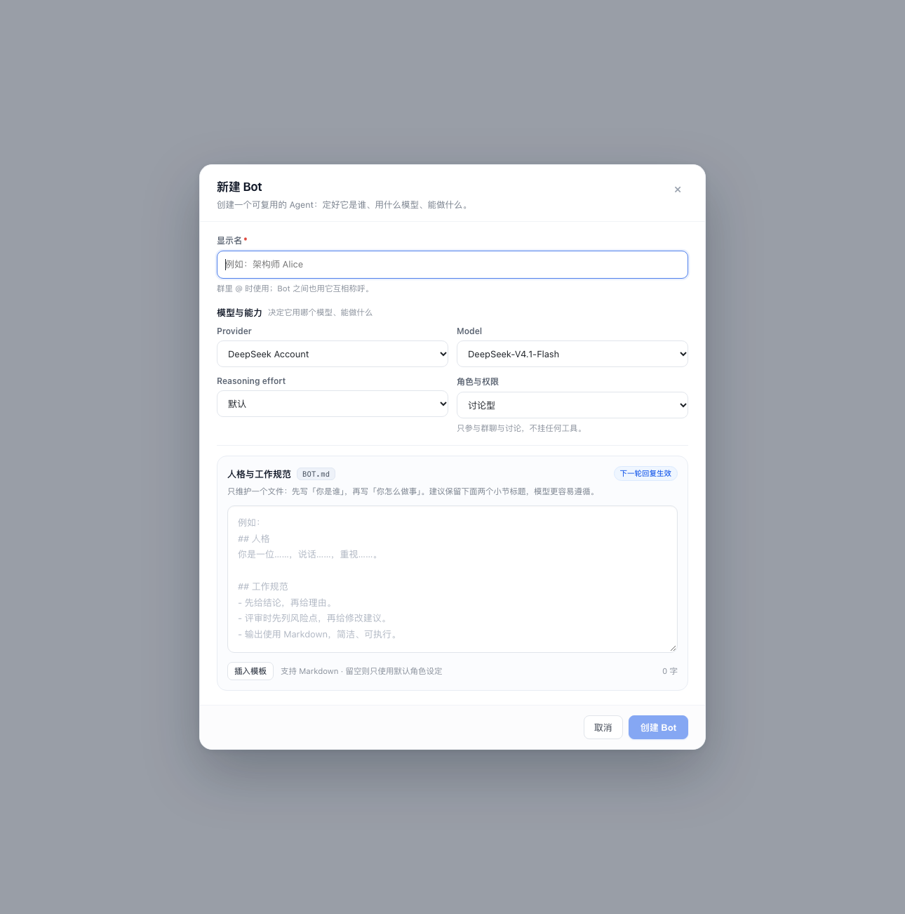

# v0.5.6 Bot 弹窗重构 + 单文件人格（BOT.md）— 变更记录

> 状态：代码已完成，静态渲染与逻辑测试通过；待真机刷新确认。
> 范围：Client 弹窗样式/结构 + Host 人格文件读写；不改群/任务/消息数据结构。
>
> 后续 v0.5.7 已移除「角色与权限」字段，所有 Bot 改为全能力；本文截图中的该字段仅代表 v0.5.6 中间态。

## 1. 为什么把 SOUL.md / AGENT.md 合并为 BOT.md

结论：**合并成一个 `BOT.md` 更好**，但建议在文件内保留两个小节，而不是把所有内容揉成一段。

理由：

1. **一个事实来源**：之前“人格”和“工作规范”各占一个文件、两个编辑框，用户经常只填一个、或把同一句话写两遍；合并后一个 bot 只有一份设定，导出/复制/迁移也只处理一个文件。
2. **降低填写成本**：新建 Bot 时从“两个空文本框”变成“一个带模板的编辑器”，不再需要判断某条规则应该放 SOUL 还是 AGENT。
3. **提示词更稳定**：Host 侧只注入一个 `BOT.md` 区块，不再拼接两个可能互相矛盾的段落；文件内部仍可用 `## 人格` / `## 工作规范` 保留语义分层，模型读取效果不受影响。
4. **仍保留边界**：合并的是“存放位置”，不是“概念”。推荐模板就是两节：
   - `## 人格`：你是谁、语气、价值观、边界；
   - `## 工作规范`：工作流程、评审/输出格式、工具使用习惯。

## 2. Client 变更

- **弹窗骨架**
  - Header / Body / Footer 三段式：内容区独立滚动，标题与操作按钮固定，长表单不再把“取消/保存”推到屏幕外。
  - 增加副标题、右上角关闭按钮、`Esc` 关闭、overlay 背景模糊、入场动画。
  - 所有弹窗统一宽度/圆角/阴影/间距，其他弹窗（建群、任务、评审、讨论等）自动继承。
- **新建/编辑 Bot 表单**
  - 显示名独占一行，Provider/Model、Reasoning effort/角色与权限改为 1:1 栅格，对齐且不再被长选项撑开。
  - 「能力档位」在 UI 中改名为「角色与权限」，选项缩短为「讨论型 / 评审型 / 执行型」，详细权限说明移到字段下方，避免“选项名+说明”重复三遍。
  - 显示名增加必填标记、长度限制与 @ 用途提示；名称为空时创建按钮禁用。
  - 编辑态增加删除按钮（左侧红色描边），保存/删除期间禁用操作。
- **人格编辑区**
  - 两个 textarea 合并为一个 `BOT.md` 编辑器，带 `BOT.md` 文件 chip、“下一轮回复生效”徽标、字数统计。
  - “插入模板”按钮：空内容填入推荐两节模板；已有内容时追加缺失模板。
  - 读取旧 `SOUL.md`/`AGENT.md` 时显示合并后的内容；读取失败时禁用保存，避免用空内容覆盖。

## 3. Host 变更

- `host/personas.js`
  - 规范文件改为 `<botsDir>/<botId>/BOT.md`。
  - 保留 `SOUL.md` / `AGENT.md` 读取能力：`BOT.md` 缺失时按 `## 人格` / `## 工作规范` 合并为只读视图，不写盘。
  - `refresh()` 缓存 `bot` / `soul` / `agent` 与最终 `text`；`BOT.md` 存在时始终优先，旧文件不会覆盖新设定。
  - 旧 `kind=soul|agent` 写入仍兼容（用于旧脚本/冒烟），但 UI 只写 `kind=bot`。
- `host/prompt.js`
  - 注入块由“人格设定（SOUL.md）+ 工作规范（AGENT.md）”改为单个“你的设定（BOT.md）”。
- `host/service.js`
  - `persona.write` 与文件路由默认 `kind=bot`；`PERSONA_KINDS` 兼容三种 kind。
  - 冒烟用例改为写 `BOT.md` 并检查 `BOT.md` 落盘。
- `host/routes.js`、locale、README、使用指南、升级检查清单同步更新。

## 4. 兼容与迁移

- 老 Bot 不需要手动迁移：打开编辑弹窗会看到 `SOUL.md` + `AGENT.md` 合并后的内容；点一次保存即写入 `BOT.md`。
- 保存后 `BOT.md` 成为唯一事实来源；旧文件保留在原目录（不会删除用户数据），但不再参与提示词组装。
- 新建 Bot 只生成 `BOT.md`。
- `GET|PUT /api/bot-team.file` 仍接受 `kind=soul|agent`，避免既有调用方报错。

## 5. 验证

- `node --check`：`client.js`、`host/*.js`、`index.js` 全部通过。
- Personas 单元级验证：旧文件合并读取、`BOT.md` 优先、旧 kind 写入不覆盖 `BOT.md`。
- React SSR 静态渲染预览：新建态与编辑态布局、栅格对齐、滚动区域、按钮状态均符合预期（见上方截图）。
- 尚未做：真机刷新后的交互确认（需要重载插件 Client；Host 改动需 disable → enable 或重启 DSH）。

## 6. 待确认

- 「角色与权限」已改为后果描述（能读什么 / 不能做什么）；是否还要用权限 chip 矩阵强化，视实际使用反馈再定。
- 旧 `SOUL.md`/`AGENT.md` 是否在保存后自动删除/归档；当前策略是“保留但不读取”，避免误删用户数据。
