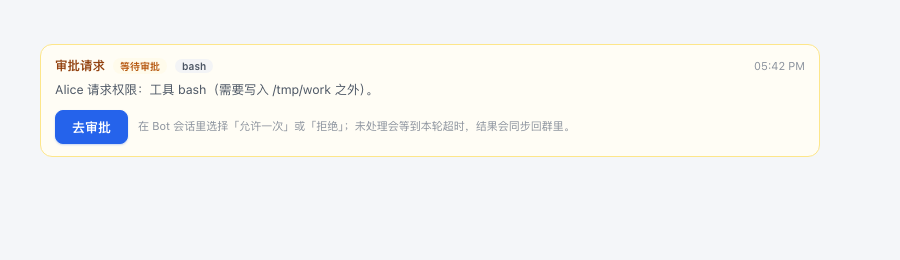

# v0.5.8 Bot 审批流（ask）— 变更记录

> 状态：代码已完成，静态渲染与逻辑测试通过；待真机刷新确认。
> 目标：Bot 不再被 `never` 一刀切拒绝；需要越界/升权时可以申请一次性权限，由用户在群里看到并去 Bot 会话审批。

## 1. 行为变化

- 默认审批策略从 `never` 改为 **`ask`**（`botApprovalPolicy: ask`）。
- workspace-write 内无需审批的读写/命令照常直接执行。
- 越界写入、沙箱升权等需要审批的操作：
  1. 群时间线出现「审批请求」卡片，显示 Bot 名、工具名、原因；
  2. 点「去审批」打开该 Bot 的 DSH 会话；
  3. 在 Bot 会话的审批面板选择「允许一次」或「拒绝」；
  4. 结果通过 `approval/decided` 同步回群里的卡片（已允许一次 / 已拒绝 / 已取消 / 审批不可用）。
- 无人处理时，本轮最多等到 `turnTimeoutMs`（默认 5 分钟）；超时后卡片标记为已取消。
- `botApprovalPolicy: never` 仍保留：无头/CI 场景下确定性地拒绝所有需审批操作。

## 2. 实现

- `host/agents.js`
  - `approval.setPolicy(agent, config.botApprovalPolicy)`，默认 `ask`。
- `host/engine.js`
  - 监听 `session/event` 的 `approval/asked` / `approval/decided`：
    - `approval/asked` → 生成 `kind: 'approval'` 时间线消息，`meta.approvalState = 'pending'`；
    - `approval/decided` → 更新 `meta.approvalState` 并广播 `message.updated`；
    - 任务结束时清理仍 pending 的审批卡片为 `cancelled`。
  - 审批消息不进入 Bot 的上下文（`formatContextMessage` 过滤 `kind === 'approval'`）。
- `host/util.js` / `cordis.patch.yml`
  - 新增 `botApprovalPolicy`（默认 `ask`，可选 `never`）。
- `client.js`
  - 新增 `ApprovalRow` 卡片：状态徽标、工具名、原因、时间、「去审批」按钮；
  - 点「去审批」调用现有 `openBotSession(sessionId)` 打开 Bot 会话；
  - 审批结果通过正常的 `message.updated` 事件刷新卡片状态。

## 3. 安全边界

- 审批是**一次性**的：每次请求只能允许一次，不支持“永久允许”。
- 审批在 Bot 自己的 DSH 会话里完成；群页面只负责提示与跳转，不直接替用户批准。
- 审批卡片只展示工具名与原因，完整命令/参数以 Bot 会话里的审批面板为准。
- `ask` 依赖 Web 审批 UI；如果运行环境没有应答者，请求会 fail-closed 为 `unavailable`。
- 目录内的破坏性命令仍然不会被审批拦截（审批只覆盖沙箱升级/越界等需要权限的操作），群工作目录仍需谨慎选择。

## 4. 验证

- `node --check`：`client.js`、`host/*.js`、`index.js` 全部通过。
- Engine 单元测试：`approval/asked` 生成卡片、`approval/decided` 更新状态、任务结束清理 pending。
- React SSR 静态渲染：审批卡片布局正常（见上方截图）。
- 尚未做：真机刷新后的完整审批链路（需要 DSH 审批 UI 与真实工具升权；Host 改动需 disable → enable 或重启 DSH）。
