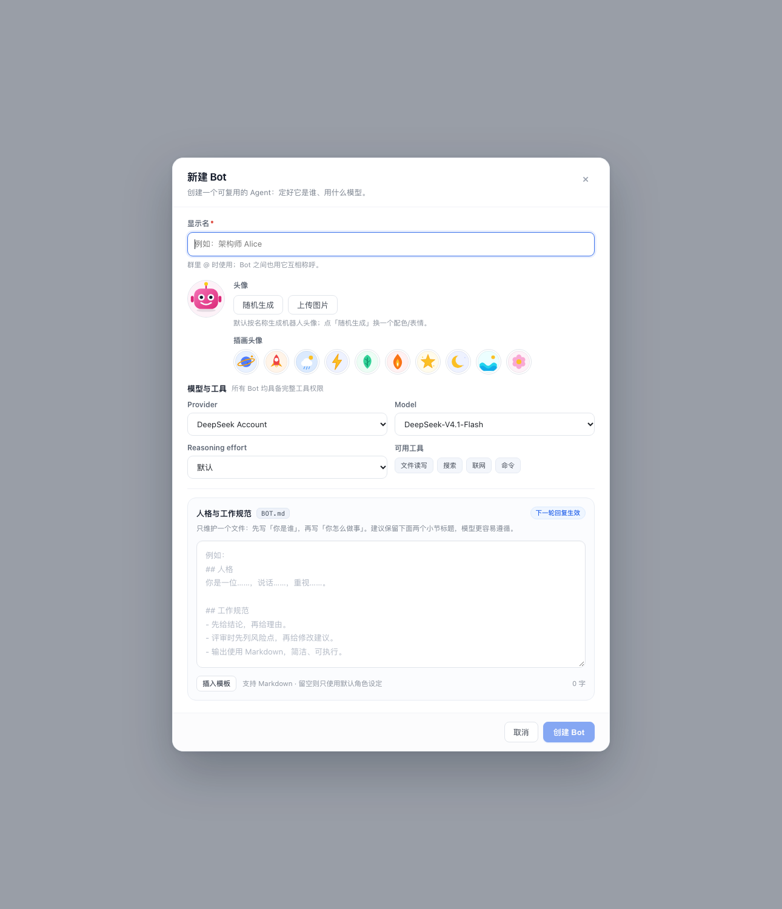
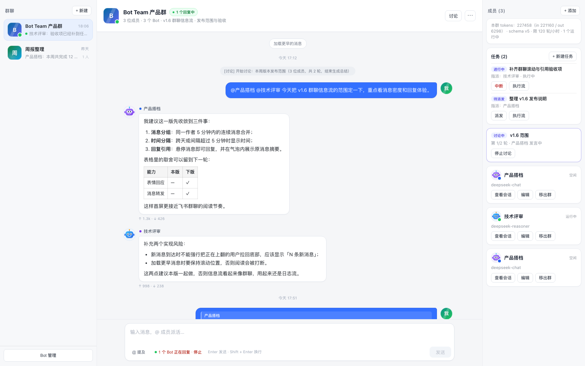

# v0.5.9 Bot 头像（机器人面具 + SVG 插画包）— 变更记录

> 状态：代码已完成，静态渲染与逻辑测试通过；待真机刷新确认。
> 目标：Bot 除了名称/模型/人格，还能有干净、可识别、符合 Bot 主题的默认头像；同时提供一套可选的 SVG 插画头像。

## 1. 方案

默认头像采用**程序化机器人面具**：

- 圆角头 + 天线 / 侧耳 + 渐变机身；
- 4 种变体：圆眼/护目镜、微笑/平嘴、有无天线、腮红；
- 8 组配色（蓝、紫、青、橙、粉、靛、teal、灰）；
- 全部用内联 SVG + CSS 渐变绘制，不依赖 emoji 字体、不引入图片包；
- 同一 seed 永远得到同一头像，刷新/重启不变。

另提供一套 **10 个本地 SVG 插画头像**，用户可在表单里直接选：

`星球 / 火箭 / 云朵 / 闪电 / 叶子 / 火焰 / 星星 / 月亮 / 海浪 / 花朵`

选择机器人而不是几何字母/方格：Bots 场景下“脸”比抽象图形更容易识别，22px 消息头像也能读出表情；插画包则给需要更强图形感的用户一个现成选择。

## 2. 头像来源

- **按名称生成（默认）**：无头像时，用 Bot 名称做种子，生成机器人头像。
- **随机生成**：点「随机生成」生成新种子（`preset:r-…`），立即换配色/表情/天线；保存后固定。
- **SVG 插画包**：在「插画头像」一行选一个，存为 `art:<id>`；纯本地 SVG，不走网络。
- **自定义上传**：选本地图片，浏览器自动居中裁切为 **256×256**，编码为 WebP（fallback PNG），存为 data URL。
- **重置**：已选随机/插画/上传图片时出现，回到按名称生成。

## 3. UI

- Bot 表单在「显示名」下方增加头像区：
  - 左侧 60px 预览；
  - 右侧「随机生成」「上传图片」按钮，已选头像时显示「重置」；
  - 下方「插画头像」一行：10 个 SVG 插画，点击即选中。
- 头像统一用于：
  - 消息作者行；
  - 群成员卡片（头像右下角保留运行状态点）；
  - Bot 管理列表；
  - 右侧 Bot 库；
  - @ 选择器；
  - 讨论成员列表；
  - 审批请求卡片。
- 无头像的旧 Bot 自动按名称生成机器人头像；旧 `preset:fox`、`preset:grid-1` 等 ID 仍可读取，只是作为配色/变体种子。
- **账号头像**：自己的消息优先使用 DSH 登录账号的昵称与 `avatarUrl`（Client 调 `remote.account.getProfile`）；账号头像不写入 Bot 数据，加载失败/未登录/无头像时回退渐变字母。

## 4. 存储与校验

- Bot record 可选字段 `avatar`：
  - `''` / 省略：按名称生成；
  - `preset:<seed>`：机器人头像种子；
  - `art:<id>`：SVG 插画包（10 个白名单 ID）；
  - `data:image/(png|jpeg|webp|gif);base64,...`：自定义图片。
- Host 侧 `normalizeAvatar()` 校验：
  - `preset:` 只允许 `[a-z0-9-]{1,40}`；
  - `art:` 只允许 10 个内置插画 ID；
  - 仅接受上述图片 MIME；
  - data URL 最大 800,000 字符。
- Client 侧上传限制：原图 ≤ 8MB；压缩后 data URL ≤ 700,000 字符。
- 头像直接存在 bot record 里，随 bootstrap 下发；没有新增文件路由，也没有改 domain schema 版本。

## 5. 验证

- `node --check`：`client.js`、`host/*.js`、`index.js` 全部通过。
- React SSR 静态渲染：机器人头像预览、10 个插画、随机/上传/重置按钮布局正常（见上方截图）。
- 机器人配色/变体是纯函数；插画是本地 SVG 常量，不依赖网络。
- 尚未做：真机上传图片、刷新后头像持久化、长名称/自定义头像在消息列表中的视觉确认。

## 6. 注意

- 自定义头像存在 bot record 中，群导出/备份会随 `storages/bot_team` 一起走；不会写进 `BOT.md`。
- 头像只影响展示，不改变 Bot 的模型、人格或工具权限。
- 名称变化会让「按名称生成」的机器人变化；想固定请点「随机生成」、选一个插画或上传图片。
