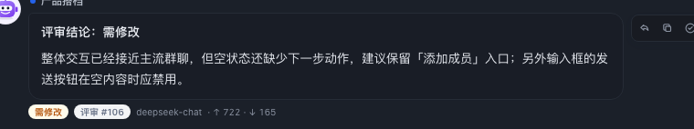
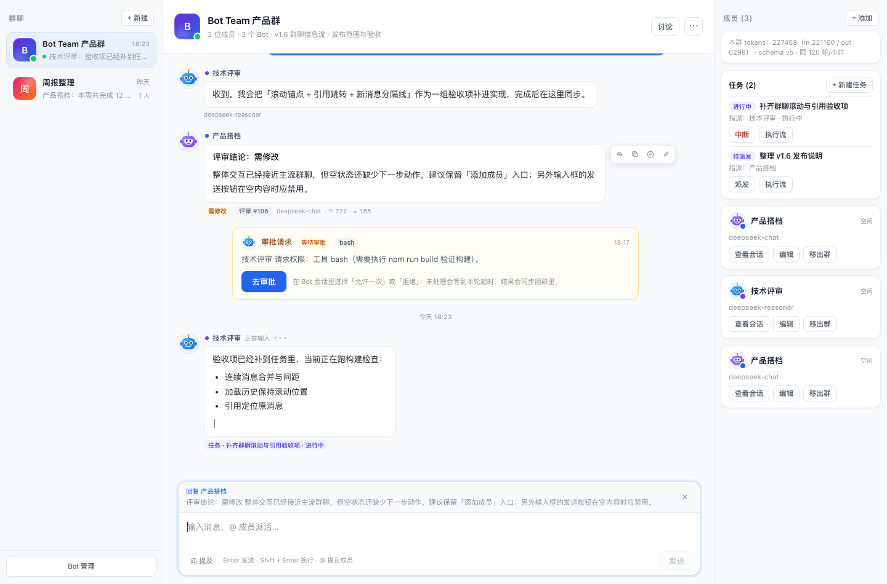

# v0.6 群聊信息流（微信 / 飞书式）— 变更记录

> 状态：代码已完成；`node --check`、静态渲染截图与无头浏览器交互检查通过。Host 侧新增了消息回复引用与模型快照，需对 `bot-team` 执行 disable → enable（或重启 DSH）后生效；仅改 Client 时可刷新页面。
> 目标：让群聊时间线从「日志流」变成主流 IM 的阅读体验——分组气泡、头像、时间分隔、悬停操作、引用回复、智能滚动，同时保留评审 / 任务 / 审批 / 流式输出。

## 1. 信息流布局

- **左右气泡**：其他成员在左（白底），自己在右（蓝底白字）；头像放在气泡外侧，自己头像在右侧。
- **作者分组**：同一作者 5 分钟内的连续消息合并为一组，只在组首显示头像和作者名，组内消息收紧间距。
- **时间分隔**：跨天或间隔 ≥ 5 分钟时，居中显示「今天 18:06 / 昨天 / 10月24日 18:06」；悬停消息可看到完整日期时间。
- **消息密度**：内容列最大 900px、气泡最大 78% / 660px；输入框与内容列同宽，宽屏阅读不散、窄屏自动收窄。
- **系统消息**：讨论开始/结束、任务系统事件改为居中灰色 pill，不再伪装成普通气泡。
- **审批卡片**：与信息流同宽居中，显示 Bot、工具、状态、原因与「去审批」入口。
- **任务 / 评审标签**：轮次、总结、评审通过/需修改、任务状态收进气泡下方的轻量标签。
- **模型与用量**：Bot 消息底部的模型与 token 用量默认隐藏；悬停消息时显示生成该回复所用模型（title 内含 provider / reasoning effort）和 `↑ 输入 · ↓ 输出` token 用量，保持默认阅读干净。

- **群列表**：增加群头像、最近消息时间、成员数；运行中的群在头像上显示绿点，预览文本自动清理 Markdown。
- **群头部**：群头像 + 群名 + 成员/话题摘要 +「N 个回复中」状态；「讨论」保留为主按钮，编辑群/添加成员/导出/删除收进「···」菜单。

## 2. 消息操作

鼠标悬停消息时，气泡侧边出现图标工具栏：

| 操作 | 说明 |
|---|---|
| 回复 | 在输入框上方生成「回复 某某」引用条，发送时写入 `replyTo` |
| 复制 | 复制消息原文；`navigator.clipboard` 不可用时回退到 `execCommand` |
| 评审 | 沿用现有「请人评审」流程（在评审弹窗里选择评审者） |
| 修改 | 评审消息且已有 verdict 时，让作者按意见修改 |
| 重试 | 失败回复重试 |

其他交互：

- 引用条显示原消息作者与摘要；消息气泡内也会显示引用块。
- 点击引用块可滚动定位到原消息并短暂高亮；原消息未加载时提示先加载更早消息。
- 菜单支持点击遮罩和 `Esc` 关闭。
- 所有图标按钮都有 `title` / `aria-label`，键盘 Tab 到消息操作时工具栏会自动显现。

## 3. 智能滚动

- 打开群 / 切换群 / 首次加载：自动定位到底部。
- 正在上翻阅读时收到新消息：**不打断阅读**，底部出现「N 条新消息 / 回到底部」浮动按钮，并在第一条新消息前插入「新消息」分隔线。
- 滚回底部后，自动清除未读提示与分隔线。
- 加载更早消息时记录并恢复滚动锚点，不再把用户拽回底部。
- 流式回复期间仅当用户停留在底部时跟随滚动；上翻后不会被流式增量反复拉回。
- 打开回复条导致输入框变高时，如果用户原本在底部，会重新贴底。

## 4. 输入框

- 白底圆角输入卡片，聚焦时蓝色描边；自动增高（44–180px）。
- 回复状态条：显示「回复 某某」、原消息摘要与取消按钮。
- `@` 提及选择器：支持 `↑` / `↓` 选择、`Enter` 确认、`Esc` 关闭；新增「@ 提及」按钮，可从按钮直接打开成员选择。
- 底部工具栏整合「@ 提及」「N 个 Bot 正在回复 · 停止」「Enter 发送 · Shift + Enter 换行」与发送按钮；空内容/发送中禁用发送。
- 发送成功后清空输入、回复状态与选择器，并贴回底部。

## 5. 数据与协议

- `message.replyTo` 字段此前已存在（Bot 回复用于关联触发消息），本版开始由人类消息正式写入：
  - Client `message.post` 新增可选 `replyTo`；
  - Host `postHumanMessage` 校验目标消息存在且属于同一群，再写入 `replyTo`；
  - 非法/跨群 `replyTo` 返回 `invalid-input`，不会分配新的消息序号；
  - 不改变 domain schema 版本，不需要迁移。
- Bot 自动回复仍保留 `replyTo` 用于上下文关联，但界面不对 Bot 自动回复展示引用块，避免每条回复都带引用；评审关系继续用「评审 #seq」标签表达。
- Bot 消息新增 `provider` / `model` / `reasoningEffort` 快照字段，在生成占位消息时写入；旧消息没有这些字段时回退显示当前 Bot 模型。不改变 domain schema 版本。

## 6. 验证

- `node --check`：`client.js`、`host/domain.js`、`host/engine.js`、`host/service.js` 全部通过。
- 模型信息：默认隐藏；悬停同时显示模型与 token 用量；历史消息无模型字段时回退到当前 Bot 模型。
- Host 单测脚本：同群回复成功写入 `replyTo`；跨群回复被拒绝；普通消息 `replyTo === null`。
- React SSR 静态渲染：分组气泡、时间分隔、引用块、审批卡片、悬停工具栏、回复条布局正常（见上方截图）。
- 无头 Chrome + Puppeteer 交互检查：
  - 悬停消息显示 4 个操作按钮（回复/复制/评审/修改）；
  - 点击回复出现「回复 产品搭档」条并聚焦输入框；
  - 头部菜单可打开，列出添加成员/编辑/导出/删除，`Esc` 可关闭；
  - 上翻后注入新消息出现「1 条新消息」按钮与「新消息」分隔线；
  - 点击「回到底部」后按钮/分隔线消失且贴底；
  - 控制台无错误、无未捕获异常。
- 截图来自本地交互预览（模拟数据），未连接真实 LLM；真实 SSE / 审批 / 流式的最终观感需刷新真机确认。

## 7. 已知限制

- 未做表情回应、消息转发、已读回执、语音/图片/文件消息；这些需要新的消息类型与 Host 路由。
- 未读状态是当前页面内的本地状态，刷新页面后不会保留；也没有左侧群的未读红点。
- 消息列表没有虚拟滚动，仍按单次最多 200 条（加载更早分页）；超长群消息很多时性能会下降。
- 回复/复制等操作以悬停为主；触屏设备通过 `hover: none` 媒体查询显示操作条，但会占用更多纵向空间。
- 群列表的最近消息预览仍以 bootstrap 数据为主，SSE 新消息不会实时改写左侧预览（刷新或下一次 bootstrap 后更新）。
- 没有消息删除/撤回、@所有人、置顶消息、消息搜索；这些是后续 IM 化候选。
