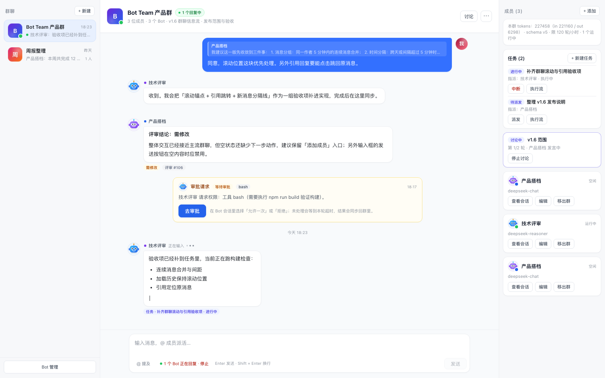

# v0.6.2 浅色 / 深色主题 — 变更记录

> 状态：代码已完成，静态渲染检查通过；待真机切换确认。
> 目标：Bot Team 页面跟随 DSH 的 light / dark / system 主题，不需要单独设置。

## 浅色

## 深色

## 1. 实现方式

DSH 的 theme runtime 会把 `body[data-ds-dark-theme]` 投影到 document；Bot Team 直接消费这个属性，不额外注入 theme 服务，也不保存第二套主题状态。

- 在 `GLOBAL_CSS` 里定义一组 `--bt-*` 设计 token：
  - 表面：`surface / bg / bg-soft / bg-subtle`
  - 文字：`text / text-strong / text-2 / text-3`
  - 边框：`border / border-strong`
  - 强调：`accent / accent-soft / accent-border`
  - 气泡：`user-bubble / user-bubble-border / bot-bubble`
  - 状态：`warn-* / danger-*`
  - 遮罩/加载：`overlay / loading`
- 浅色值定义在 `.bt-root`，深色值定义在 `body[data-ds-dark-theme] .bt-root`；
- 组件 inline style 与 v0.6 CSS 类都使用这些变量，因此 DSH 切换主题时颜色**即时更新**，无需刷新页面；
- `color-scheme: light / dark` 跟随主题，原生 select、滚动条和输入控件不会在深色下保持白色；
- 深色滚动条单独提高对比度。

## 2. 覆盖范围

- 页面三栏、群列表、聊天头部、消息时间线、输入区；
- Bot / 消息气泡、引用回复、系统提示、时间分隔；
- 成员/任务/讨论右侧面板；
- 新建/编辑 Bot、群、任务、评审、讨论等弹窗；
- 审批卡片、错误/警告、按钮、输入框、下拉框、滚动条；
- 头像（机器人/插画/上传）保持自身配色，不随主题反色。

## 3. 验证

- `node --check` 通过。
- 静态渲染：
  - 浅色 feed 截图；
  - `body[data-ds-dark-theme]` 下的深色 feed 截图；
  - 深色 Bot 表单 / 群表单弹窗检查（标题、输入框、按钮、插画网格可读）。
- 主题切换是 CSS 变量级联，不需要 React 重新挂载；
- 尚未做：真机在 DSH 设置里切换 light/dark/system 的逐项视觉确认。

## 4. 注意

- 仍有个别状态 badge（需修改/评审 #/任务状态）保留浅色底，这是为了保持语义色；如果希望深色下也统一变暗，可以继续把 badge 背景也 token 化。
- 头像插画本身带浅色底，深色下会保持原插画色调，不会强行反色。
- 深色依赖 DSH 设置 `body[data-ds-dark-theme]`；如果宿主未来改属性名，需要同步选择器。
