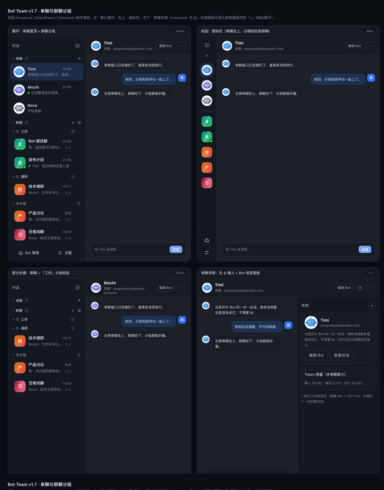
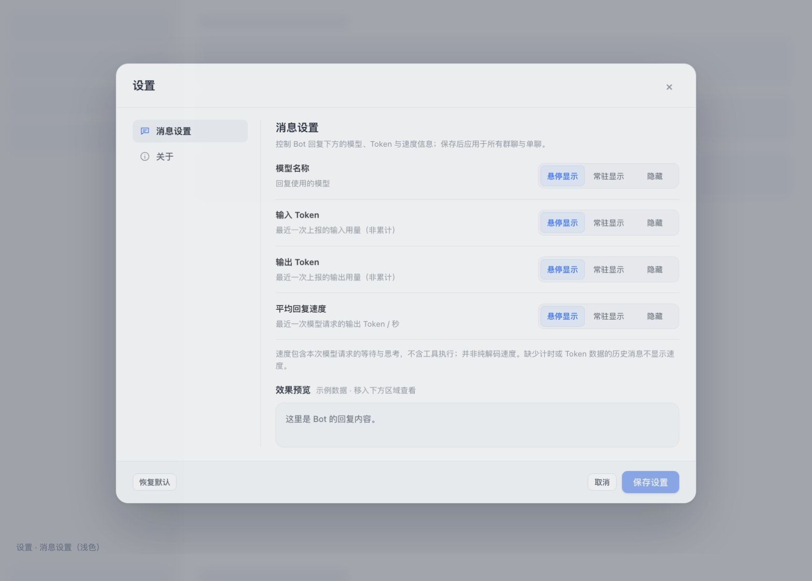
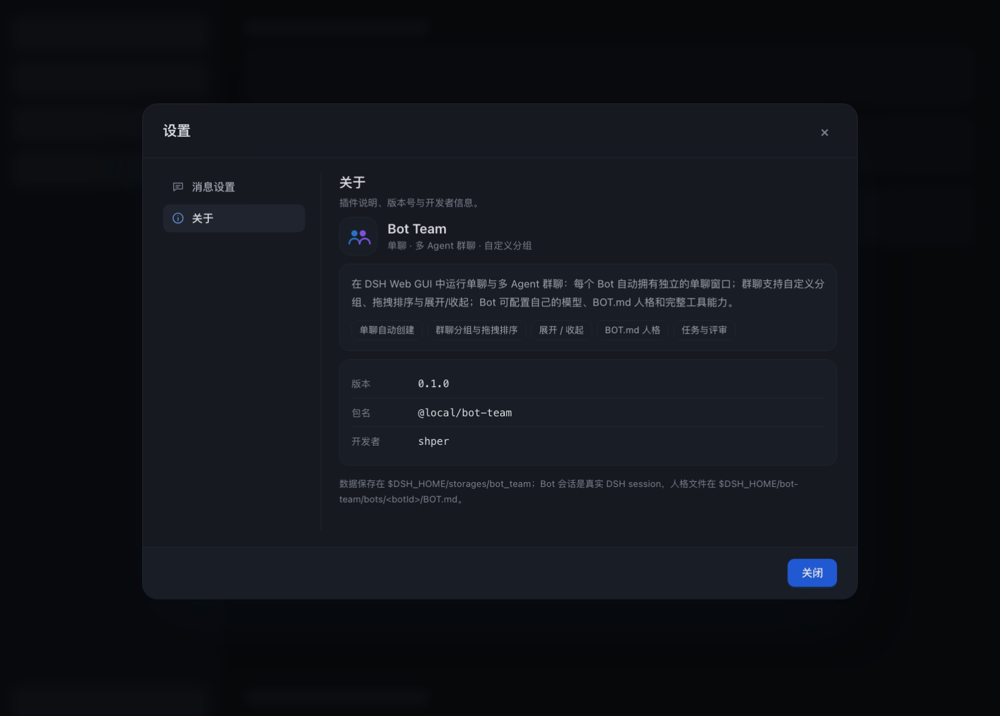

# v0.7 单聊与群聊分组 — 变更记录

> 状态：代码已完成；`node --check` 与 `node --test`（104 条）通过；用真实 `GroupList` / `DirectPanel` / `Composer` / `ChatSettingsDialog` 组件做了浅色/深色静态渲染截图检查（预览脚本与截图已清理，不属于发布产物）。本次同时改了 Host（schema v6），运行中的 GUI 需重启 DSH 或对 `bot-team` 行 disable→enable 后再刷新页面，才能加载完整功能；只刷新页面会看到「Host 仍是旧版本」提示。
> 目标：Bot 支持一对一会话；新建 Bot 后直接有单聊窗口并排在群聊上方；群聊可设置自定义分组与手动排序；单聊、群聊、未分组和每个自定义分组都能展开/收起。

静态渲染预览（真实 `GroupList` / `DirectPanel` / `Composer` + 插件 `GLOBAL_CSS`；右侧聊天区为占位 mock）：

浅色：

深色：

设置（消息设置 / 关于）：

## 1. 交互

### 单聊

- **自动创建**：`bot.create` 成功后 Host 立即创建该 Bot 的单聊（group `kind: "direct"`，一个成员），Client 在 bootstrap 刷新后自动选中它——用户看到的是「新建 Bot → 直接进入单聊」。
- **旧机器人**：schema v6 迁移给每个已有 Bot 补齐单聊；重复运行迁移不会生成第二份。
- **侧栏位置**：左侧「对话」栏固定「单聊」区在「群聊」区上方。每行显示 Bot 头像、名称、最后一条消息与时间；Bot 回复中在预览前显示绿点。
- **新建入口**：展开态头部只保留收起按钮，不再放重复的「+ 新建」；新建统一在分区标题上——「单聊 +」新建 Bot，「群聊 +」新建群/话题，文件夹图标新建分组。收起成图标栏后仍保留「新建群 / 话题」图标，避免没有入口。
- **无需 @**：单聊的每条用户消息都由 Host 自动以该 Bot 为唯一目标；输入框不再出现「@ 提及」按钮和成员选择器，提示改为「Enter 发送 · Shift + Enter 换行」。
- **完整复用**：流式输出、停止、引用/回复、复制、右键菜单、加载更早、回到底部、导出 Markdown 与 token 用量都和群聊一致；单聊有自己的 `sessionId` 与会话记忆。
- **头部**：Bot 头像、Bot 名称、「单聊 · provider/model」；常用按钮是「编辑 Bot」，「···」里是「编辑 Bot / 查看 Bot 会话 / 导出 Markdown」；没有「讨论」「添加成员」「删除群」。
- **右侧面板**：Bot 头像/名称/provider/model、累计 token 用量、「编辑 Bot」「查看会话」和 BOT.md 提示；窄屏（≤1100px）沿用右侧栏自动隐藏规则。
- **删除语义**：单聊不能单独删除（`group.delete` 会拒绝）；删除 Bot 时连同它的单聊、单聊消息、讨论与任务一起删除。单聊成员不能被移除，也不能再加第二个 Bot。
- **群聊专属流程**：单聊 UI 不提供评审、讨论、任务板；Host 也会拒绝在单聊里创建任务/发起讨论/请求评审（返回「请使用群聊」）。
- **模型工具**：`bot_team_list` / `bot_team_create_group` 仍面向多 Agent 群聊，不返回单聊；单聊消息不会进入 `bot_team_list` 的群列表。

### 群聊分组

- **新建**：「群聊」标题右侧的文件夹图标（或群操作菜单里的「＋ 新建分组…」）；名称 1–40 字，不允许同名；最多 100 个分组。
- **分配**：群编辑弹窗的「分组」下拉；右键群 / 行尾「···」→「移动到分组」下的「未分组」或某个分组；也可以直接把群拖到分组标题（追加到末尾）。
- **分组顺序**：拖动分组标题到另一个分组的上/下半区；`···` 菜单里的「分组上移 / 分组下移」提供键盘可达的替代。
- **群顺序**：同一分组内、未分组内、单聊区内都支持拖动排序（拖动行到目标行的上/下半区）；菜单里的「上移 / 下移」提供替代。跨分组拖动会在一次 `group.reorder` 里同时改 `folderId` 与顺序。
- **删除分组**：分组内群回到「未分组」，不删除群、不删除消息；确认框会显示会移动多少个群。
- **未分组**：只有存在自定义分组时显示「未分组」小节；没有分组时群直接排在「群聊」下，避免多余标题。空分组也有「分组内还没有群」提示，并可作为拖放目标。

### 设置与关于

- 左侧栏「设置」弹窗从单栏表单改成「左侧模块导航 + 右侧内容」：**消息设置** / **关于**；宽度 860，左侧导航支持 ↑/↓/Home/End 与焦点环，窄屏（≤700px）自动变成横向导航。
- 原有模型/Token/速度显示设置整体移入 **消息设置**，效果预览、恢复默认、取消、保存设置的行为不变（保存后仍关闭弹窗）。
- **关于** 模块展示：插件中文说明、功能特性 chips、版本号、包名、开发者，以及数据/人格文件位置。版本/包名/开发者由 Host bootstrap 的 `plugin` 字段下发，Host 在模块加载时读取 `package.json`（`author` 已写入 `shper`），缺元数据时客户端使用 `0.1.0` / `@local/bot-team` / `shper` 兜底。
- sidebar 的「设置」入口 aria/title 从「全局群聊设置」改为「Bot Team 设置」。

### 右侧面板

- 聊天头部新增「右侧面板」图标按钮（`bt-right-toggle`），与右侧面板标题栏的「»」一样可以收起/展开：成员、任务、讨论、单聊信息面板。收起后消息区占满剩余宽度，聊天头部的按钮仍保留用于重新展开。
- 偏好存在浏览器 `localStorage` 的 `bot-team.right-panel.collapsed`（`'1'` / `'0'`），刷新、切换群/单聊后保持；页面每次挂载重新读取。
- `≤1100px` 时右侧面板原本就由 CSS 自动隐藏，右侧面板切换按钮也一并隐藏（`@media (max-width:1100px)`）；没有选中会话时右侧是 Bot 库，不提供收起。

### 展开/收起

- 「单聊」「群聊」「未分组」和每个自定义分组左侧都有箭头按钮；点击折叠/展开，箭头旋转 90°，保留数量徽标。
- 折叠状态存在浏览器 `localStorage` 的 `bot-team.sidebar.sections`（对象：`direct: true` / `groups: true` / `ungrouped: true` / `folder:<folderId>: true`）。刷新、切走再回来保持；存储不可用（隐私模式/禁用）时静默降级为仅当前会话。
- 侧栏收起成图标栏（68px）时，分组标题和折叠箭头不显示；按「单聊头像 → 分隔线 → 群聊头像（按分组顺序展开）」排列。单聊头像有「Bot 名（单聊）」的 tooltip / aria-label；群头像保留群名 + 最后一条消息的 tooltip。

### 旧 Host 降级

只刷新浏览器、但 Host 模块还是旧版（`config.schemaVersion < 6`）时，单聊区会显示「Host 仍是旧版本：重启 DSH（或重新启用 Bot Team）后，单聊与分组才会生效」，不渲染会失败的单聊行；分组创建、拖动排序等新动作也暂时禁用，避免用户误以为功能坏了。

## 2. 数据模型（schema v6）

`bot_team` domain 仍是 version 1，record schema 从 5 升到 6：

- `groups` 新增：
  - `kind`: `"group"` | `"direct"`（旧记录迁移后统一补齐为 `"group"`）。
  - `folderId`: string | null（单聊恒为 null）。
  - `order`: integer（每个作用域内 dense：单聊区、一个分组、未分组各自从 0 开始）。
  - `botId`: 仅单聊有，指向唯一 Bot。
- 新表 `folders`：`{ folderId, title, order, createdAt, updatedAt }`。
- 单聊的确定性 id：`grp-dm-<botId>`，成员 id `mem-dm-<botId>`，session id `session-botteam-dm-<botId>`；`ensureDirectGroup()` 可重复调用。
- 迁移 v6 行为：
  1. 旧群按原有列表顺序（`updatedAt` 倒序）写入 `order`；
  2. 给每个 Bot 创建（或补齐）一条单聊与成员；
  3. 写 `meta/schema = { version: 6 }`。
- 所有 id 仍满足 per-record key 约束 `[a-zA-Z0-9_-]`。

## 3. Host

- `host/layout.js`（新）：`isDirectGroup` / `groupKindOf` / `groupFolderIdOf` / `sortByOrder` / `nextOrder` / `resolveOrdering` / `directGroupIdFor` 等纯函数，供 domain / service / 测试共用。
- `host/domain.js`：
  - 打开 domain 时归一化 `kind/folderId`，`order` 缺失保留给迁移判断；
  - 新增 `folders` 表与 `getFolder/allFolders/putFolder/deleteFolder`；
  - schema v6 迁移与 health counts.folders。
- `host/service.js`：
  - `ensureDirectGroup` / `openDirect` / `directGroups` / `groupChats` / `groupsInFolder`；
  - `createBot` 自动建单聊并返回 `directGroupId`；`updateBot` 同步单聊标题；`deleteBot` 清理单聊、消息、讨论、任务；
  - `createGroup` / `updateGroup` 支持 `folderId`；`deleteGroup` 拒绝单聊；`addMember` / `removeMember` 拒绝对单聊操作；
  - `postMessage`：单聊自动把唯一成员作为 mention，群聊保持「无 @ 不回复」；
  - 新增 actions：`folder.create` / `folder.update` / `folder.delete` / `folder.reorder` / `group.reorder` / `direct.open`；
  - `group.reorder` 支持 `movedGroupId`（跨分组移动）和 `orderedIds`；短/过期列表不会丢记录（未列出的作用域成员会追加到末尾）；
  - bootstrap 增加 `folders`、`directGroupCount`；单聊/群聊都走同一个时间段、SSE 与 Engine；
  - 冒烟升级到 `smoke-v11`，新增 `directChatPerBot` 与 `groupFolderLifecycle` 两项（共 25 项）。
- `host/prompt.js`：单聊的人格/上下文改成「正在与用户单聊」；turn prompt 说明「用户刚发来单聊消息，直接回复」，不再要求 @。
- `host/tools.js`：`bot_team_list` 过滤 `kind: "direct"`。

## 4. Client

- 侧栏模型 `buildSidebarModel(state)` 是唯一渲染来源：单聊（按 Bot，Nova 无单聊时也显示可创建行）、分组（按 `folder.order`，组内按 `group.order`）、未分组；未知/已删除的 `folderId` 回落到未分组。
- 新增纯函数便于测试：`findSidebarGroup` / `scopeGroupIds` / `computeGroupDrop` / `computeFolderDrop` / `stepGroupOrder` / `stepFolderOrder`，分别处理同区排序、跨分组移动、文件夹拖放与菜单上移/下移。
- `GroupList` 重写：
  - 分区标题、文件夹、未分组、行菜单、拖放高亮；
  - 右键菜单 `SidebarMenu`（固定定位、视口内收、Esc/滚轮/点空白关闭、方向键切换、焦点回到首项）；
  - 分组行和单聊行右侧「···」按钮（悬停/键盘聚焦显示，触屏常显）；
  - 拖放使用 HTML5 DnD；行上半区/下半区分别表示 before/after；分组标题只接受追加；单聊与群聊互相拖放会被拒绝。
- reducer 新增 `pendingDirect` / `sectionCollapsed` / `applyGroupOrder` / `applyFolderOrder`；`bootstrap` 在 `pendingDirectBotId` 命中时自动选中单聊，旧 Host 不会卡在 pending。
- `BotTeamPage`：新建/编辑 Bot 后，新建时 dispatch pending；`GroupFormDialog` 接收 `folders` / `folderId` 并返回新群；新增 `FolderFormDialog`；单聊页头、空状态、`DirectPanel`、`Composer`（无 @、placeholder/aria 调整）按 `group.kind` 分支。
- 侧栏展开/收起状态：`bot-team.sidebar.sections`；沿用 v0.6.5 的 localStorage 降级策略。
- 视觉：新增分区标题、文件夹、未分组、行菜单、拖放指示、图标栏分隔线、单聊右侧面板样式；深色 token 复用 `--bt-*`。

## 5. 验证

- `node --check bot-team/client.js` 与 `host/*.js` 全部通过。
- `node --test bot-team/test/*.test.js`：**104 条全部通过**（原 80 条 + 本次 16 条 client + 7 条 host + 1 条真实 Service 启动/路由/工具集成 = 104）。
  - `test/direct-grouping-client.test.js`（15 条）：侧栏模型排序/未知分组回落、单聊区在群聊上方、折叠 reducer 与 localStorage、图标栏顺序、拖放计算、乐观排序、pending 单聊选择、单聊 Composer/DirectPanel/页头、右侧面板收起/展开与持久化、群与文件夹弹窗、旧 Host 降级。
  - `test/direct-groups-host.test.js`（7 条）：createBot 自动单聊、重命名/删除同步、单聊自动 mention 与群聊 @ 规则、单聊操作保护、分组 CRUD/排序/删除回退、单聊独立排序、schema v5→v6 迁移与幂等。
  - `test/chat-settings-client.test.js`：新增「消息设置 / 关于」模块与插件元数据断言（页面同时传入 `pluginInfo`）。
  - `test/service-integration.test.js`（1 条）：真实 `BotTeamService` 构造/初始化，注册 6 条路由与 8 个模型工具，通过 dispatch 建 Bot/分组/群并校验 bootstrap。
- 用真实存储目录的**只读副本**模拟 v6 迁移：2 个旧 Bot、1 个旧群、8 条消息 → 迁移后 3 个会话（1 群 + 2 单聊）、4 个成员、schema 6，旧消息不变。
- 静态渲染截图（临时文件已清理）：`tmp/direct-preview/preview-light.png` / `preview-dark.png`（展开、图标栏、部分折叠、单聊详情四种状态）与 `tmp/settings-preview/messages-light.png` / `about-dark.png`（消息设置 / 关于）；用 Chromium 无头渲染真实组件 HTML + `GLOBAL_CSS`。
- 文档截图：`docs/assets/v0.7-single-chat-grouping-light.png`、`v0.7-single-chat-grouping-dark.png`、`v0.7-settings-light.png`、`v0.7-settings-about-dark.png`。

## 6. 升级

1. 备份 `$DSH_HOME/storages/bot_team` 与 `$DSH_HOME/bot-team/bots`。
2. 重新安装/更新 bundle（或对 `bot-team` 行 disable → enable，或重启 DSH）以加载新的 Host 模块。
3. 刷新页面。首次 bootstrap 会自动跑 schema v6、补齐单聊。
4. 不需要重建 domain；旧群/消息/任务/讨论原样保留。

## 7. 注意

- 单聊固定一对一；删除 Bot 会删除其单聊与消息（不可恢复，删除前有确认）。
- 分组只有一层，不支持嵌套；分组删除后群回到未分组。
- 自定义排序在 Host 持久化；展开/收起是浏览器偏好，不跨设备同步。
- 图标栏模式不显示分组标题；折叠状态保留但不影响图标栏。
- 拖放依赖 HTML5 DnD；所有拖放操作都有菜单替代（上移/下移/移动到分组），键盘可完成。
- 同一浏览器多标签页之间没有全局布局 SSE：在另一个标签页里新建分组/排序后，当前标签页需要刷新或触发一次自身刷新（群消息 SSE 仍实时）。
