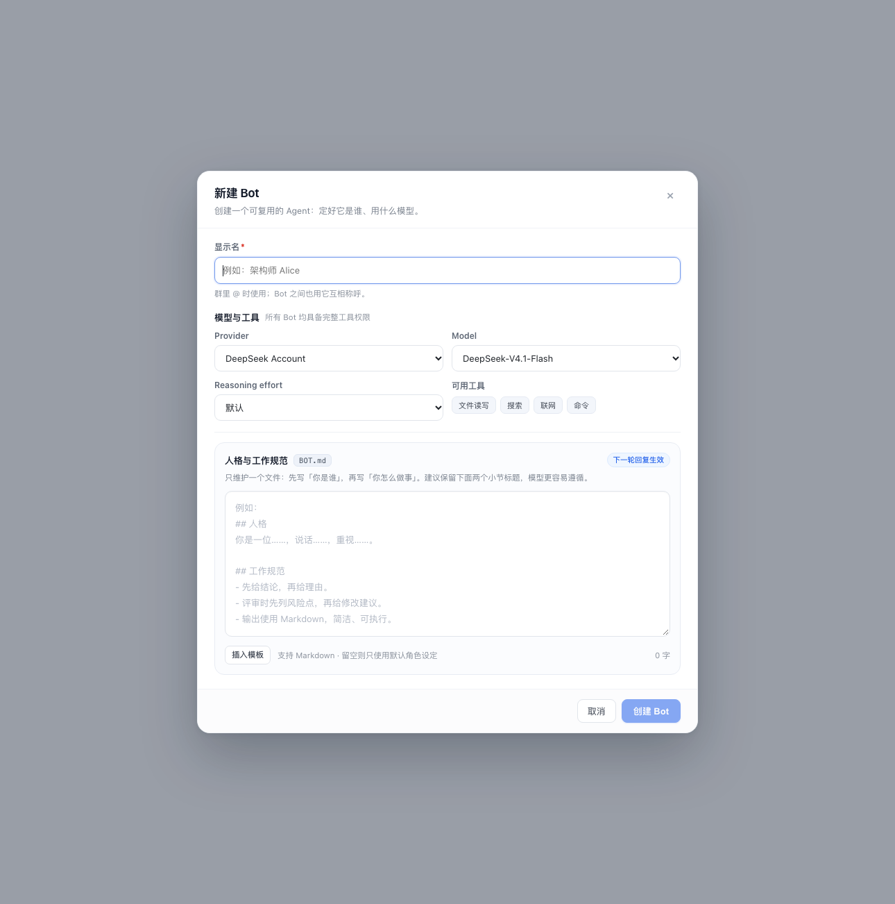

# v1.5.7 全能力 Bot（移除角色与权限）— 变更记录

> 状态：代码已完成，静态渲染与逻辑测试通过；待真机刷新确认。
> 目标：Bot 不再分「讨论型 / 评审型 / 执行型」，所有 Bot 默认拥有完整工具权限。
>
> 后续 v1.5.8 已把默认审批策略从 `never` 改为 `ask`，并加入群内「审批请求」卡片；本文中的 `never` 描述为 v1.5.7 当时状态。

## 1. UI 变更

- 删除「角色与权限」下拉框；Bot 表单只保留显示名、Provider、Model、Reasoning effort。
- 在 Reasoning effort 右侧增加静态「可用工具」提示：`文件读写 / 搜索 / 联网 / 命令`。
- 移除 Bot 列表、群成员、@ 选择器、评审者/讨论成员下拉、Bot 管理、导出 Markdown/HTML 中的「讨论型/评审型/执行型」标签。
- 新建/编辑 Bot 的副标题与文案同步改为「所有 Bot 默认具备完整工具权限」。

## 2. Host 变更

- `host/agents.js`
  - 所有 Bot 统一挂载 `bot-team-tools` preset（tool-fs、fs-search、web、bash、todo）。
  - `applySandboxMode()` 统一写入 `workspace-write`。
  - 删除只读 guard 与 capability-specific deny；仍保留 Team 工具 / `bot_team_*` 的递归防护。
- `host/prompt.js`
  - 删除 `CAPABILITY_LABEL / CAPABILITY_PRESET / CAPABILITY_DENY`。
  - 人格提示改为通用「全能型 Bot」：讨论、评审、执行三种工作方式都写清楚。
  - 群成员名单只显示名称与模型。
- `host/service.js`
  - `bot.create` 固定写入 `capability: 'work'`，不再读取/校验 capability，不再受 `allowWorkBots` 限制。
  - `bot.update` 不再修改 capability。
  - 删除 bootstrap/health 中的 `allowWorkBots` 字段。
- `host/domain.js`
  - schema 升到 v5：启动时把所有旧 Bot 的 `capability` 归一化为 `work`。
- `host/tools.js`
  - `bot_team_list` 不再返回 capability。
  - `bot_team_create_group` 删除 `capability` 参数与校验；新 Bot 一律全能力。
- `host/util.js` / `cordis.patch.yml`
  - 删除 `allowWorkBots` 配置。
  - 删除不再使用的 `bot-team-basic` preset；`bot-team-tools` 改名「Bot Team · 全能」。

## 3. 兼容性

- 旧 `talk` / `review` Bot 无需手动操作：schema v5 迁移为 `work`，下一轮重建 agent 后即获得完整工具。
- 旧调用方如果仍传 `capability`，会被忽略；不会报错。
- 旧 session 的 `agentPreset: bot-team-basic` 不影响 resume：setup 按当前代码统一挂载 `bot-team-tools`。
- `allowWorkBots` 若仍留在 profile 配置中会被忽略，可以删除。

## 4. 安全边界（重要）

- **所有 Bot 都能读写文件、执行命令**；审批策略仍固定为 `never`。
- `never` 的含义是**所有需要审批的操作一律拒绝**，不是自动批准：workspace-write 内无需审批的读写/命令正常执行；越界写入、沙箱升权等需要审批的操作直接失败并返回拒绝文本，Bot 无法弹审批窗口。
- 目录内的破坏性命令不会被审批拦截（只有提示词约束），所以群工作目录必须选对。
- 可访问范围由群工作目录（`workspaceCwd`，未配置时用 `defaultCwd`）限制；同一个群里的 Bot 权限完全相同。
- 执行型开关已取消；如果要收紧权限，需要在 preset / 工具层重新引入分级，而不是靠 UI 开关。
- 建议给不同项目建不同群并设置各自 `workspaceCwd`，不要在有敏感文件的目录里随意拉 Bot。

## 5. 验证

- `node --check`：`client.js`、`host/*.js`、`index.js` 全部通过。
- Prompt 单元测试：通用职责、BOT.md 注入、成员名单不含旧档位。
- Personas 测试：BOT.md 优先、旧文件合并、清空不回退。
- React SSR 静态渲染：新表单布局与工具 chips 正常（见上方截图）。
- 尚未做：真机刷新后的 UI/交互确认；Host 改动需 disable → enable 或重启 DSH。
