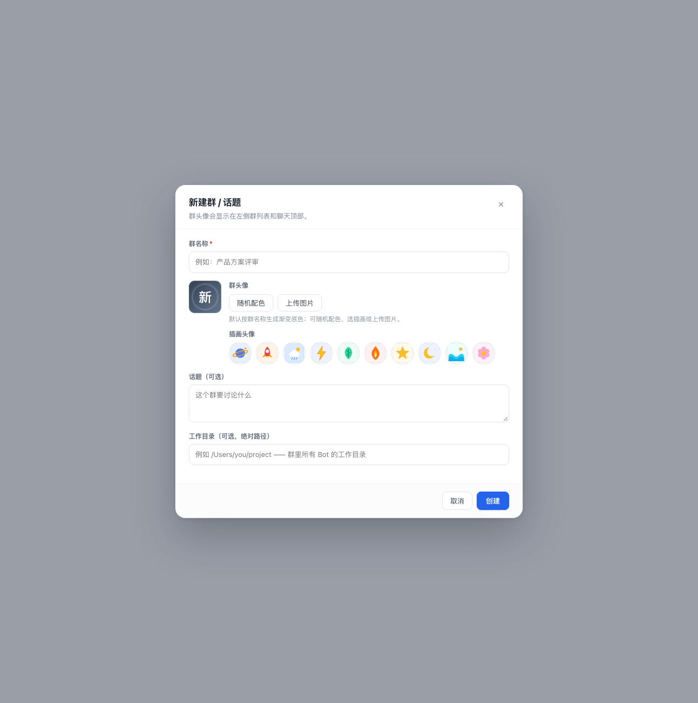

# v1.6.1 群头像 — 变更记录

> 状态：代码已完成，静态渲染与逻辑测试通过；待真机刷新确认。
> 目标：群也能像 Bot 一样设置头像，而不是只能显示名称首字。

## 1. 能力

群新建/编辑弹窗新增「群头像」：

- **默认**：按群名称生成渐变底色 + 名称首字；名称变化时底色随之变化。
- **随机配色**：点「随机配色」生成新种子（`preset:r-…`），立即换一组渐变。
- **SVG 插画包**：复用 Bot 的 10 个本地 SVG 插画（星球/火箭/云朵/闪电/叶子/火焰/星星/月亮/海浪/花朵）。
- **自定义上传**：图片自动裁成 **256×256**，编码为 WebP（fallback PNG），存为 data URL。
- **重置**：回到按名称生成。

群头像显示在左侧群列表和聊天顶部；自定义/插画头像保存后立即同步（`group.updated` SSE）。

## 2. 存储

`group.avatar` 可选字段：

- `''` / 省略：按名称生成；
- `preset:<seed>`：渐变配色种子；
- `art:<id>`：SVG 插画（10 个白名单 ID）；
- `data:image/...`：自定义图片。

Host 复用 `normalizeAvatar()`：`preset` 语法、`art` 白名单、图片 MIME 与大小校验都与 Bot 头像一致。不需要 schema 迁移。

## 3. 实现

- `host/service.js`：`group.create` / `group.update` 接收并保存 `avatar`。
- `client.js`：
  - `GroupAvatar` 支持渐变 / 插画 / 上传图片；圆角方形，与群列表一致。
  - `GroupFormDialog` 增加头像预览、「随机配色」「上传图片」「重置」与插画网格。
  - 复用 `createAvatarDataUrl()` 做上传压缩，与 Bot 头像同一套限制。
- 群头像的随机种子/插画/上传数据都在客户端生成，Host 只做校验与持久化。

## 4. 验证

- `node --check`：`client.js`、`host/*.js`、`index.js` 全部通过。
- React SSR 静态渲染：群表单头像预览、按钮、插画网格布局正常（见上方截图）。
- Host 复用现有头像校验；群记录额外字段通过现有 recordSchema（允许额外字段）。
- 尚未做：真机上传/刷新的持久化确认，以及群列表/顶部在真实数据下的视觉确认。

## 5. 注意

- 群头像与 Bot 头像共用 `art:<id>` 白名单；如果以后扩充插画包，需要同步 Host 的 `AVATAR_ART_IDS`。
- 群头像只影响展示，不改变群成员、模型或工作目录。
- 名称变化会让「按名称生成」的底色变化；想固定请随机配色、选插画或上传图片。
