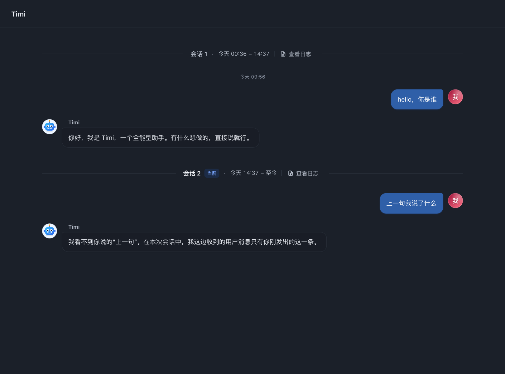
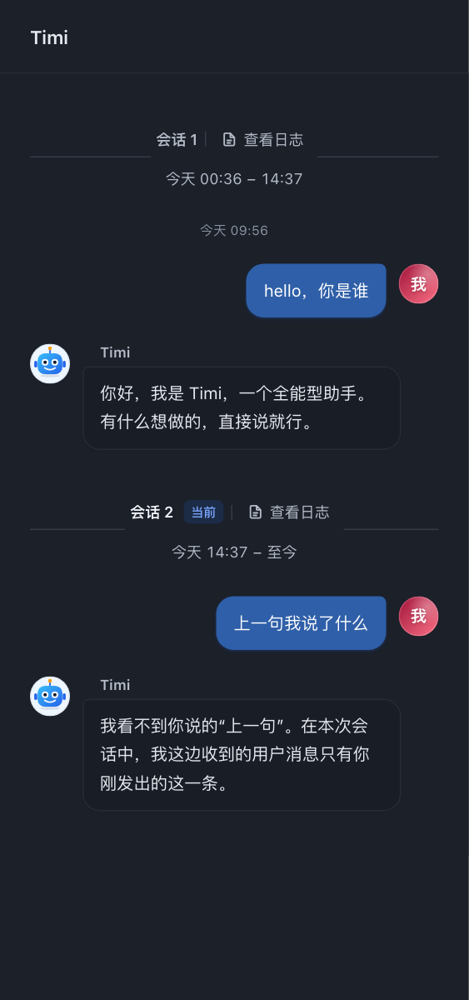

# 会话分隔 UI 与时间范围

2026-10-28

会话分隔从三行标题、时间、按钮改为两侧细线与居中的紧凑信息条。历史会话展示创建时间到下一次新建会话的时间，当前会话展示“至今”和浅蓝色“当前”标签。

- 同日省略结束端日期；跨日保留两端日期，跨年或历史年份补全年份。
- 时间支持悬停、键盘聚焦查看完整日期、秒数和时区，Escape 收起提示。
- 查看日志入口常显，打开所选会话原有日志弹窗。
- 小于 560px 的消息列改为两行，第一行为会话名称、状态与日志，第二行为时间范围。
- 仅合并与紧邻会话边界同一分钟、同一会话且不早于创建时间的首条消息时间；保留未读分隔与消息分组。
- 结束边界必须满足同组、previousConversationId 指向当前会话、ordinal 连续。分页缺少直接后继、无效或倒序时间均显示“结束时间未知”，不推测结束时刻。

## 验证

- npm run check 通过。
- npm test：630 通过，15 按环境条件跳过，0 失败（基于本次隔离提交）。
- 新增 6 个组件行为测试，覆盖同日、跨日、跨年、中英文本、时间异常、分页缺失、空会话、首条时间去重与日志目标。
- Chromium 加载实际客户端 React 组件，验证深浅色下 1080、520、375、320px 窗口，以及英文跨年范围；无页面或分隔组件横向溢出。
- 浏览器验证键盘完整时间提示、Escape 收起、点击历史会话日志打开对应弹窗。

真实组件截图（隔离示例数据）：

[交互设计稿](design/session-divider-proposal.html)保留新旧结构和深浅主题的对比。此文件是设计预览，正式实现位于客户端消息列表。

## 当前 GUI

本机 GUI 通过 link 插件加载工作区的纯 JavaScript 客户端，无额外打包步骤。合入后，从 http://127.0.0.1:59920/plugins/events 读取到插件 revision d75921c190f9；对应客户端响应 HTTP 200，源码与工作区逐字节匹配，包含本次范围计算及分隔条样式。当前工具无法接管已认证桌面窗口，因此此项验证证明服务端已提供新版本，页面 DOM 的刷新结果与上述隔离组件验证区分。
