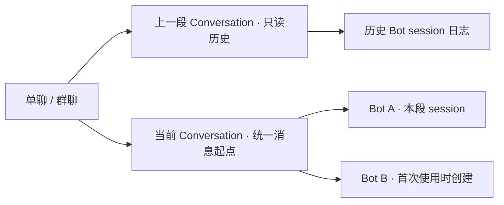

**Bot Team 单聊与群聊 /new 详细实施方案**

编写日期：2026-10-28。状态：工作区实现与本地回归已完成，待加载到现有 GUI 验收。当前已落地 schema 7、会话提交与执行隔离、原生生命周期检查、Client 入口与草稿/历史展示；最终 npm run check 与 npm test 通过，共 629 项，614 通过、15 按条件跳过、0 失败。以下保留详细设计与验收要求，完成状态以实际执行记录为准，不据此宣称已发布或当前 GUI 已完成验收。

**0. 实际执行状态与 M0 依据。** 本轮采用并行实现、隔离测试与故障注入，未通过真实模型对话试探记忆是否清空。

| 范围 | 当前落地与验证状态 |
|---|---|
| M0 原生边界 | 安装版 Electron 契约复验 14/14 通过，覆盖 owned 后台 root、真实 child、Job、inbox、goal 及 descendant drain；使用临时存储，禁止 LLM 调用，不操作真实聊天。external/unknown 终态不可可靠查询的限制仍保留 |
| M1 数据 | schema 7、旧聊天基线、conversations/session_bindings、严格提交与单调指针已实现；隔离测试覆盖准备/指针写失败、重开恢复、同 request 幂等及空段 |
| M2 Service/Engine | 已实现排他切换、已接纳写入 drain、上下文/回调代际校验、按需 session、历史任务限制、HTTP 409 与提交后 SSE；新增行为测试与最终整体验证均通过 |
| M3 Client | 已实现 `/new`、+ 与顶部入口、草稿保护和跨窗口采用、版本合并、分隔与历史日志、分段导出；交互测试、语法检查与插件打包检查通过 |
| M4 集成 | 最终 629 项：614 通过、15 跳过、0 失败。14 项 Electron 契约已另行全部通过；另 1 项跳过是当前已有 CJK 字体时不适用的无字体反向测试。语法、差异与打包检查通过。现有 GUI 未登录检查为 401，未安装或重载插件，浏览器操作验收尚未执行 |

M0 的可复核依据为 [native-runtime-contract.test.js](<../bot-team/test/native-runtime-contract.test.js>)（实际加载安装版 Agent、Job、Goal、Subagent、SessionQuery 等服务）与 [conversation-native.test.js](<../bot-team/test/conversation-native.test.js>)（未知状态、冷 inbox、维护活动及代际保护）。SDK 契约确认：根 Agent idle 不代表子代理或 Job 已终止；无唤醒的审批策略说明可识别为非工作注记，但未知 inbox 内容仍阻塞。`external`/`unknown` 后代的 inactive 不作为安全证明，owned 根释放须等待公开 drain，Job 仍按各自归属和终态检查；缺能力或查询异常会拒绝切换。

Service/HTTP 的原子提交、故障恢复、在途同 request 合并、草稿版本冲突与空段边界测试已加入 [conversation-service.test.js](<../bot-team/test/conversation-service.test.js>)、[conversation-http.test.js](<../bot-team/test/conversation-http.test.js>)；其他领域分别由 [conversation-domain.test.js](<../bot-team/test/conversation-domain.test.js>)、[conversation-engine.test.js](<../bot-team/test/conversation-engine.test.js>) 和 [conversation-client.test.js](<../bot-team/test/conversation-client.test.js>) 覆盖。这里列出验证依据，不替代最终全套运行结果。

**1. 产品目标。** 在当前单聊或群聊中开始一段新的独立对话，让用户能继续使用同一位 Bot、同一个团队和同一个项目，明确结束上一段对话上下文。

| 项目 | 第一版决定 |
|---|---|
| 指令 | 输入框完整输入 `/new`，或点击「+ → 指令 → 新建会话」「顶部 ··· → 新建会话」 |
| 单聊范围 | 当前单聊里的 Bot |
| 群聊范围 | 本群全部成员，包含当前停用的成员；重新启用后同样从新会话开始 |
| 保留 | 聊天身份、群成员、人格与模型设置、群主题、工作目录、项目文件、附件文件、历史消息、执行日志、累计用量 |
| 新上下文 | 不自动携带上一会话的聊天、执行历史、压缩摘要、目标或任务状态 |
| 历史展示 | 沿用同一条聊天时间线，插入明确的会话分隔；历史仍可向上翻阅 |
| 历史执行 | 第一版提供查看、导出和明确选取内容到当前会话；旧会话不恢复为当前执行会话 |
| 运行中 | 拒绝切换，说明阻塞来源；用户停止或等待工作真正结束后重试 |
| 生效方式 | 全群在一个提交点切换逻辑会话，各 Bot 首次需要 Agent 时创建新的底层 session |
| 后续扩展 | 指定单个成员重开、切回旧会话、会话分支、自动携带摘要，可另行设计 |

这里的上下文隔离针对对话和执行历史；人格、项目文件以及用户明确要求读取的信息继续可用。新建会话本身不请求模型、不消耗模型 Token，也不重置每日预算。

交互文案建议：单聊菜单说明为「开始新的对话上下文，历史仍可查看」；群聊为「为本群全部成员开始新会话」。成功后显示「已开始新会话」。空闲时直接执行，无需额外确认弹窗。

**2. 设计起点与实现约束。** 以下保留方案编写时核实的基础行为和改动动因；实际调整已进入第 0 节所列实现与测试，后续仍须保持对应约束。

| 现状 | 依据 | 对方案的影响 |
|---|---|---|
| 单聊同样是 group，每个 Bot 固定一个单聊；群成员各自保存 sessionId | [domain.js:420](</Users/shper/Documents/11_dsh_plugin/dsh-bot-team/bot-team/host/domain.js#L420>)；[service.js:1833](</Users/shper/Documents/11_dsh_plugin/dsh-bot-team/bot-team/host/service.js#L1833>) | 在聊天内部增加会话层，不重复创建 Bot 或群 |
| AgentPool 根据 sessionId、工作目录和 preset 恢复或轮换 Agent | [agents.js:153](</Users/shper/Documents/11_dsh_plugin/dsh-bot-team/bot-team/host/agents.js#L153>) | 必须额外判断逻辑会话是否匹配 |
| 普通上下文来自 lastSeenSeq 之后的消息 | [engine.js:297](</Users/shper/Documents/11_dsh_plugin/dsh-bot-team/bot-team/host/engine.js#L297>) | lastSeenSeq 需受当前会话边界约束 |
| ensure 引起 session 轮换时，会从 seq=0 回填时间线 | [engine.js:327](</Users/shper/Documents/11_dsh_plugin/dsh-bot-team/bot-team/host/engine.js#L327>) | 目录切换、preset 升级也必须遵守当前会话边界 |
| 存储按记录写入，宿主没有跨表事务；现有部分 repo 方法先改 Map 再等待写盘 | [domain.js:305](</Users/shper/Documents/11_dsh_plugin/dsh-bot-team/bot-team/host/domain.js#L305>)；[persistence.md:26](</Users/shper/Documents/11_dsh_plugin/dsh-bot-team/research/persistence.md#L26>) | 采用单记录提交点，新增严格持久化写入方法 |
| 已有目录切换的 admission 保护和繁忙检查 | [service.js:1386](</Users/shper/Documents/11_dsh_plugin/dsh-bot-team/bot-team/host/service.js#L1386>) | 扩展成共享的聊天操作保护，覆盖 /new 与目录切换 |
| 输入框当前将正文发往 message.post，斜杠用于 Skill 选择 | [client.js:8853](</Users/shper/Documents/11_dsh_plugin/dsh-bot-team/bot-team/client.js#L8853>) | 新增内建命令识别与优先级，不能只加菜单按钮 |
| 历史日志目前由成员当前 session 或消息 execution 引用证明归属 | [execution.js:263](</Users/shper/Documents/11_dsh_plugin/dsh-bot-team/bot-team/host/execution.js#L263>) | 增加独立持久的 session 归属，避免换会话或删消息后失去旧日志入口 |
| stopGroup 与 whenIdle 不构成完整的后台工作结束屏障 | [engine.js:1339](</Users/shper/Documents/11_dsh_plugin/dsh-bot-team/bot-team/host/engine.js#L1339>) | 第一版采用完整 busy 检查，不实现「自动停止并立即新建」 |

**3. 核心模型。** 使用三个层次，避免把群聊误建成一个共享模型 session。




一个聊天只有一个当前 Conversation。一个 Conversation 内，每位成员可以有零个或多个原生 session：尚未使用的 Bot 为零个；正常使用通常为一个；切换项目目录或迁移 preset 后可能有多个。

必须保持以下不变量：

1. group.activeConversationId 是当前执行会话的唯一权威。
2. 成员、作业与原生 session 的 Conversation 不匹配时，不能接受新输入或被恢复为当前执行。
3. 群内所有成员在同一个指针提交点失去上一会话的执行资格，不存在一半成员已切换、一半仍继续旧上下文的可见状态。
4. 自动构造上下文的最小消息序号始终大于当前 Conversation.afterSeq。
5. 历史日志归属与当前执行资格分开验证，旧日志可以读取，但读取不激活 Agent。
6. 会话切换成功只能在持久化提交之后返回；崩溃恢复不能根据客户端缓存猜测当前会话。
7. 新建会话保持群内消息 seq 连续递增，历史消息不重新编号。

**4. 数据结构。** 将插件记录版本从 schema v6 升为 v7，保留现有 DOMAIN_VERSION=1。新增 conversations、session_bindings 两张持久表，内存索引使用 conversations/sessionBindings；不向 DSH 原生日志添加插件自定义事件。

| 对象 | 新增或明确的字段 | 用途 |
|---|---|---|
| group | activeConversationId、conversationVersion | 单记录当前指针及单调版本 |
| conversation | conversationId、groupId、ordinal、previousConversationId、afterSeq、createdAt、reason、requestId | 不可变的逻辑会话记录；保存历史链和幂等请求 |
| member | sessionConversationId | 标记当前保存的 sessionId 属于哪段逻辑会话；沿用 sessionId、lastSeenSeq、previousSessionIds |
| sessionBinding | bindingId、sessionId、groupId、conversationId、membershipId、botId、botNameSnapshot、createdAt、reason | 独立于成员和消息生命周期的原生 session 归属 |
| message | conversationId、可选 quote 快照 | 新消息显式记录归属；旧消息通过迁移基线与边界兼容读取；quote 只在用户明确引用时保存 |
| job | conversationId | 入队时固定归属，用于提交与异步回调检查 |
| task / discussion | conversationId | 区分本会话任务与历史任务，约束自动派发和继续讨论 |
| interaction | conversationId | 验证问答、审批及其异步回应属于当前会话 |

示例：

```json
{
  "conversationId": "conv_example_2",
  "groupId": "grp_example",
  "ordinal": 2,
  "previousConversationId": "conv_example_1",
  "afterSeq": 180,
  "createdAt": 1793152800000,
  "reason": "user-new",
  "requestId": "request_example"
}
```

afterSeq=180 表示这段会话的自动消息上下文只允许 seq>180。分隔线位于第 180 条之后；它是由 Conversation 元数据生成的视图条目，不占用 message.seq，也不能被当作普通消息删除。

新建记录的 ordinal 等于 group.conversationVersion+1；previousConversationId 指向切换前当前会话。只有能从 group.activeConversationId 沿历史链到达的记录才视为已提交。历史会话结束边界由下一条已提交会话的 afterSeq 推导，无需修改上一条记录。

sessionBindings 记录由 Host 生成。记录键使用符合 storageDomain 键规则的稳定编码或摘要，不能直接假设所有宿主 sessionId 均适合作为文件键。会话归属来自已验证的成员或 execution 引用，不接受客户端任意登记 sessionId。

同一原生 session 只归属一段 Conversation。更新工作目录导致原生 session 轮换时，新旧 session 可以归属同一 Conversation。绑定写入发生在新 session 创建或首次输入之前；绑定存在不等于日志文件已经生成，日志读取仍返回真实 availability。

保留 previousSessionIds 兼容当前逻辑，但历史读取改以 sessionBindings 为持久依据。移除成员后，属于仍然存在的聊天的历史绑定继续保留；删除整个聊天时，按既有删除语义清理插件记录，原生日志文件的处理遵守现有规则。

**5. /new 的可靠切换流程。** 推荐采用「准备不可变记录 → 严格提交当前指针 → 按需创建成员 session」，避免批量修改所有成员产生部分成功。

顺序如下：

1. 校验 groupId、requestId、expectedConversationId 和调用来源；先检查该 requestId 是否已有已提交结果。
2. 同步取得群级排他切换权。在第一个 await 之前关闭本群新的输入、派发、Agent 准备、目录切换和成员变更入口。
3. 在保护内检查当前会话仍等于 expectedConversationId；检查全部繁忙来源。
4. 等待本群已发起的相关持久化操作完成，确认没有失败尚未处理；从单调 group.nextSeq 固定 afterSeq 和成员快照，不能使用可因删除消息而倒退的 lastMessageOf。
5. 释放插件拥有的旧 Agent handle，等待释放完成；不提前修改成员持久映射。对非插件持有的 live Agent 必须通过宿主契约确认可安全退出，否则返回明确的 busy/不支持原因。
6. 在释放后再次核对原生活动、成员快照和当前指针，再写入新的不可变 Conversation 记录。该记录在指针提交前对普通查询不可见。未能阻止独立原生输入的 borrowed Agent 不允许在检查后继续切换。
7. 通过严格方法更新 group.activeConversationId 与 conversationVersion；成功写盘后再发布新的内存值。这一步是唯一提交点。
8. 立即使旧会话的执行资格失效，清理按成员缓存的当前执行/交互视图；对旧 session 的只读历史入口保持可用。
9. 发出 conversation.started，返回已提交的 Conversation 和当前版本，释放排他保护。

新逻辑会话提交时不调用 agents.create。这样一个含多个成员但只会 @ 一位 Bot 的群，不会为了 /new 提前创建所有原生 session。

需要新增严格存储方法，例如 commitConversation、putMemberStrict、putSessionBindingStrict，以及本群相关写入的等待机制。它们必须复制记录、等待后端成功，再替换 repo Map；不能包装现有 putGroup/putMember 后就声称具备该保证。

切换保护必须与普通发送、成员增删、群设置更新、目录切换、Skill 查询引起的 ensure 共用。所有可能写回 group/member 的路径都要避免用旧对象覆盖新的 activeConversationId 或 sessionConversationId；使用集中式字段更新，并在持久化串行队列内复核版本。这里沿用现有单 Host 写入假设，不新增多进程写入支持。

| 失败位置 | 应有结果 |
|---|---|
| 繁忙或预期会话冲突 | 无持久状态变化，返回阻塞来源或最新会话 |
| 部分旧 handle 已释放，其余释放失败 | 当前指针仍为旧会话；已释放成员可按旧映射重新恢复；不显示成功 |
| Conversation 准备记录写入失败 | 当前指针保持旧值 |
| 准备记录成功，指针写入失败或提交前崩溃 | 未被当前历史链引用的记录不可见；恢复后继续旧会话 |
| 指针持久成功，响应前断开或崩溃 | 恢复后使用新会话；同 requestId 重试返回原结果 |
| 指针提交成功，首次创建新 Agent 失败 | 新会话仍有效；该 Bot 本次回复报错，可以重试创建；不回退到旧 session |
| SSE 丢失 | action 响应、bootstrap 或重连 hello 恢复权威状态 |

requestId 的已提交结果需与请求 groupId 和预期父会话匹配。重放较早的一次成功请求，不再切换指针；响应同时返回该次创建结果和现在的当前会话，避免客户端倒退。重复网络请求只创建一段；用户再次明确执行 /new 可以创建新的空段，按 ordinal 排序且不创建无用原生 session。

**6. 繁忙判定与原生生命周期。** 新增统一的 collectConversationBlockers(groupId)，前端按钮状态与 Host 最终检查使用同一语义。

繁忙来源包括：Engine 的 running、queue、activeBySession、pendingWork；正在进行的 discussion；AgentPool 的 preparing 和异步 setup；原生 Agent 正在执行、维护尚未完成或 inbox 含未执行工作；已授权续跑的 goal；仍在运行的子代理或与旧 session 绑定的后台作业；未完成的提问、审批及正在提交的回答；本群其他排他变更。

已接纳、无运行目标且只剩持久化的输入走第 5 节 drain：关闭新输入后等待本群写链，等待期间旧指针保持、没有新段 SSE，成功后 afterSeq 包含该输入；失败返回 storage-failed 并保留旧指针。尚在准备/提交的操作仍按 admission 返回 busy，不能把等待已接纳写入与运行中执行混为一谈。

未开始的历史任务草稿、已经暂停且未授权继续的 goal、已完成的日志查询不作为运行中阻塞。任务草稿在切换后归入旧 Conversation，不再进入当前会话自动派发。

现有 stopGroup 会在中止 job 时触发 finishJob/pump，whenIdle 也没有覆盖 pendingWork，因此 /new 不以这两个方法返回作为安全证明。用户点击既有停止入口之后仍需重新检查实际状态。若今后支持「停止并新建」，应另行实现关闭派发、清空队列、取消源头、排空后台工作、再切换的完整流程。

M0 已用安装版宿主公开服务验证受管子代理、Job 归属及根释放时的后代 drain，依据见第 0 节；这不等于证明所有外部子代理或 shell 后台进程都会随根 handle 自动结束。实际实现逐一检查关联 Job，只将 completed/failed/killed 视为终态；external/unknown/诊断型后代不能仅凭 inactive 判定已结束。不能根据 agent.status='idle' 推断工作已结束，也不能仅屏蔽事件就让它继续修改工作区。对无法可靠判断的旧 session 工作返回具体阻塞信息；宿主缺少必要能力时关闭新建入口并说明原因。

当前公开 SDK 没有可靠的 external 子代理终态查询，`catalog.activity=inactive` 不能替代执行已结束的证明。冷重启后已存在的 external/unknown 目录记录仍按 unknown busy 处理；没有可验证终态时可能持续阻塞，不承诺停止或重启后即可 /new。

**7. 成员按需创建 session。** 首次需要 Agent 包括发送消息、派发任务和查询 Skill 列表，不能只在普通发送中实现。

建议 ensure 内采用以下顺序：

1. 在聊天操作保护内读取最新 group、Conversation 和 member，保存预期 conversationId。
2. 若 member.sessionConversationId 不等于当前 Conversation，强制使用全新 sessionId；即使旧日志不存在，也不能沿用旧 ID。
3. 先为旧 session 补齐历史归属，再为新 ID 写入绑定；严格保存新 member 映射，其中 lastSeenSeq 初始化为当前 afterSeq。
4. 创建带原生默认 preset 的后台根 Agent，保留现有 origin 和权限配置方式，不把旧 session 的 events、摘要或 goal 作为 seed。
5. 每个关键 await 后验证当前 Conversation、成员版本和 Agent 身份仍匹配，再发布 handle 或提交输入。
6. 如果同一 Bot 跨过多次 /new 都未执行，直接从最后实际使用的 session 转入当前会话，中间各段保持没有该 Bot 的原生日志。

工作目录或 preset 导致的原生 session 轮换同样通过此映射与归属机制，但不改变 Conversation；回填仅来自该 Conversation。

需要统一 isCurrentMembershipSession 等纯判断，并接入以下全部路径：AgentPool 构造恢复、agent/created、memberForSession、current、setup、模型变更回调、submit；Engine 的 recoverNativeSessions、adoptNativeTurn、inbox claim、goal continuation、流式输出及 session/event；BackgroundInteractions 自己的成员扫描、reconcile、respond。

历史所有权判断不能复用这个只接受当前会话的函数，否则旧日志会被错误禁用。

另一个实施陷阱：startJob 当前在 ensure 前取得 member 对象并修改 lastSeenSeq。严格存储改为写盘后换对象后，旧引用可能失效。必须改为 ensure 后重新读取成员，根据实际 session 与 Conversation 决定回填，仅对最新版本执行单调游标更新；禁止 touchMember(oldMember) 将旧映射写回。

**8. 上下文与跨段动作。** 普通增量上下文下界为 max(member.lastSeenSeq, conversation.afterSeq)；新原生 session 的重建上下文下界为 conversation.afterSeq。两者均受 triggerSeq 上界和现有 maxContextMessages 规则约束。

所有自动补历史路径均走同一 Conversation 范围选择函数，涵盖新成员加入、停用后启用、工作目录切换、冷恢复、preset 升级、任务 prompt、评审和讨论。不能只改普通聊天 buildTurnPrompt。

| 用户动作 | 当前段 | 历史段 |
|---|---|---|
| 查看、复制、导出、定位消息 | 正常 | 正常 |
| 重试失败回复 | 验证目标仍属于当前 Conversation 后执行 | 拒绝直接重试，提示选取原请求到当前会话重新发送 |
| 回复/引用消息 | 按既有逻辑 | 用户明确选取时，将选中消息快照作为本次引用带入当前会话；不补入整段历史 |
| 请人评审、让作者修改 | 验证所有目标与作业属于当前段 | 第一版禁止直接触发旧执行链；可选取内容到当前段提出新请求 |
| 任务自动派发、依赖推进 | 只考虑当前段任务 | 不自动执行；需要继续时创建当前段的新任务，依赖逐项重建 |
| 继续讨论、自动总结 | 当前讨论内推进 | 保留历史，不自动恢复；用户可在当前段发起新讨论 |
| 删除普通历史消息 | 沿用已有状态和引用检查 | 不影响 Conversation 边界或 sessionBinding |
| 查看原生执行过程与日志 | 固定实际 sessionId | 固定旧 sessionId，保持只读 |

显式引用历史内容由 Host 在接纳发送时校验同一个聊天、目标消息仍存在、附件引用有效，并保存 quote 快照（原 messageId、conversationId、作者、正文、附件和 capturedAt）到这条新消息。若目标在接纳前被删除，拒绝发送并保留草稿；接纳后删除原消息不撤销已明确复制到新消息中的引用。引用计入输入大小上限，超限返回错误，不静默截断。prompt 注入选中快照而不补入周边消息，引用内容不作为新的管理命令处理。现有 replyTo 主要是关联信息，必须补齐实际快照传递，不能只保存旧 messageId。

每个 job 固定 conversationId，提交前、每个会改变共享状态的异步回调前再次检查。晚到的旧事件可以结算原有旧消息或被忽略，不能新建当前段回复、推进新任务、更新新成员游标或重新装配旧 Agent。

**9. HTTP、SSE 与工具契约。** 新建操作复用现有经过认证的 POST action 路由。

```json
{
  "action": "conversation.new",
  "payload": {
    "groupId": "grp_example",
    "expectedConversationId": "conv_example_1",
    "requestId": "request_example"
  }
}
```

返回 result 包含 created、conversation（本次请求创建的完整记录）、currentConversationId、conversationVersion。同 requestId 重放时 created=false；返回原请求结果及现在的权威当前状态，不再次切换。

| 接口 | 改动 |
|---|---|
| POST /api/bot-team.action | 新增 conversation.new；执行类 action 增加 expectedConversationId |
| GET /api/bot-team.bootstrap | capability；各 group 附当前 Conversation、version、canStartConversation/blockers；成员附当前段是否已有 session |
| GET /api/bot-team.messages | 保留全聊天消息分页，附 conversationBoundaries 和当前 ID/version，边界与消息分开 |
| GET /api/bot-team.conversations（新增） | 按 groupId、beforeOrdinal、limit 分页读已提交会话；指定 conversationId 时读详情和可分页的 sessionBindings |
| GET /api/bot-team.events | 新增 conversation.started；hello 附当前会话与版本；执行帧附 conversationId |
| 历史日志、执行过程与 JSONL 导出 | 沿用已有路由，扩展可信历史归属、legacy fallback 与读前读后校验 |

conversations GET 不创建/恢复 Agent。所有查询校验所属聊天，只返回已提交历史链；按群/会话建立索引，避免反复全表扫描。messages 的 boundaries 覆盖页首消息所属会话、页内边界以及最新页尾部尚无消息的当前段；大量连续空段通过独立元数据游标补取，不改变消息 limit/hasMore 的含义。

错误约定：conversation-busy、stale-conversation、historical-target、reload-required 返回 409；invalid-input、invalid-command、command-required 返回 400；not-found 返回 404；storage-failed/session-release-failed 返回 500；宿主能力缺失返回 conversation-capability-unavailable/503。details 包含阻塞原因或最新会话，不能返回成功但未提交。实际响应结构沿用 `{ok:false,error:{code,message},details:{...}}`，details 位于顶层；HTTP 映射已同步调整，缺少预期会话与 stale 请求在入队前返回 409。

message.post、retry、review、discussion、task 等产生执行的外部请求必须携带 expectedConversationId，在同一入场保护内校验。内部模型工具适配器在受保护入口取得当前 ID，并固定到本次请求及派生 job；旧目标仍须单独检查。尤其 task.accept 引发的 unblockDependents/autoDispatchReady 不能派发旧段任务。第一版不新增让 Bot 自行 /new 的模型工具。

Host 对 message.post 中精确 /new 返回 command-required，要求走明确的管理 action，避免旧客户端误送模型。普通正文、引用、代码、模型输出不触发管理动作。SSE 只在提交后发布；现有 SSE 没有历史重放，断线后依靠 hello/GET 恢复权威状态。

**10. 命令与草稿交互。** 新增小型内建命令解析，Skill 选择器继续保留。+ 菜单、顶部更多菜单共用 startConversation；完整 /new 的执行优先于 Skill picker 的 Enter 处理。

| 输入/操作 | 行为 |
|---|---|
| 整条 trim 后等于 /new，大小写敏感 | Enter 或发送按钮执行 |
| / 或 /ne 上选择命令项 | Enter 先补全 /new，下一次 Enter 执行；Tab 始终只补全 |
| /new 后有正文、参数或另一行正文 | 提示「请单独发送 /new」，保留全部草稿 |
| 正文内 /new、URL、代码块、/newer | 普通内容，不触发管理动作 |
| IME Enter、Shift+Enter | 保持输入/换行，不执行命令 |
| Skill 加载失败/为空、没有 Bot | 内建项仍可显示；是否可执行由 Host capability/busy 判定 |
| Skill 同名 new | 整条 /new 为内建保留语法；提示名称冲突，不插入会误触的文本；可用自然语言明确要求加载该 Skill |
| Host 不支持能力 | 禁用入口；手输 /new 也不能降级成普通消息 |

输入提示改为「/ 选择指令或 Skill」，补中英文、键盘和屏幕阅读器文案。完整 /new 不应因空 Skill 列表而吞掉第一次 Enter。

增加 draftConversationId、draftRevision 和同步 inFlightRef。发送/新建捕获 groupId、expectedConversationId、requestId、draftRevision；回包只消费本次快照，不能清掉等待期间的新正文、附件或其他聊天草稿。

本地菜单新建成功：保留正文、手动 @、附件与上传状态，绑定新会话；清除旧 replyTarget，并移除仅由回复自动插入且未被修改的 @。文本指令成功：只消费当次 /new 控制文本。失败保留输入。发送与新建互斥，使用同步 ref 防止同一 render 的双击。

远端窗口新建：空草稿可自动绑定新 ID；非空草稿保持原归属，显示「聊天已开始新会话，草稿已保留」，用户点击「将草稿用于当前会话」后再绑定。409 不自动重发。上传晚回包校验附件 itemId/草稿版本，不复活已删除附件；切会话不改变 Composer key，也不触发清空输入的 effect。

**11. 时间线、日志和导出。** 保留 messagesByGroup、hasMoreByGroup、deletedMessageIdsByGroup，另增 conversationsByGroup 与权威版本。bootstrap、group.updated、GET、action、hello、SSE 统一通过 mergeConversationState 合并。

当前指针只接受不低于已知 conversationVersion 的值。旧 GET 的历史消息仍可合并，但其中旧指针不能覆盖新指针；同版本不同 ID 则重新拉权威状态。现有 hello.chatDisplaySettings 提前返回以及 group.updated 浅合并都需要适配。禁止把仅当前段的消息页喂给会将缺项视作删除的现有 reducer。

分隔按 afterSeq、ordinal 排序，以 conversationId 去重。相同 afterSeq 的连续空段仍保留；跨段打断作者气泡分组。分隔不计入未读、Token、消息总数和消息分页 limit，不提供普通消息删除菜单。删除整段普通消息后边界仍存在。

本地成功滚到新分隔；远端切换尊重用户正在读历史的位置。采用专用元数据合并与滚动处理，不直接复用会重新加载最新消息页的 onSent。加载更早页同时补边界，保持滚动锚点。

顶部日志入口区分「本会话日志」「本会话尚无日志」「上一会话日志」。未按需轮换前，member.sessionId 仍可能是旧段，不能标成当前。分隔提供「查看本会话日志」，按绑定选择 Bot/真实 session；绑定可保存 Bot 名称快照，移除成员后仍能辨认。

已打开执行面板和历史日志固定原 sessionId，新建不自动改向新 ID。legacy 消息无 execution 引用时，仅在旧段绑定可以唯一、可信定位时提供 fallback；否则显示关联不可用，不能指向成员当前新 session。查询历史不激活 Agent。

Markdown、HTML、PDF 第一版统一导出「整个聊天，包含所有会话分段」，输出分段标题和时间，空段也可识别；原生 JSONL 原样保留。现有 collectAllMessages 有 50 页上限，达到上限且 hasMore 时必须提示不完整，不能宣称全部导出；本期不承诺无限规模导出。

**12. 迁移与兼容。** schema v7 迁移在 AgentPool/Engine 构造恢复之前完成。

1. 每个现有聊天生成稳定基线 Conversation：ordinal=1、afterSeq=0、reason=legacy、previousConversationId=null。
2. 旧消息、task/discussion 缺省归属基线，采用读取兼容，不逐条重写历史消息；新增记录必须明确归属。
3. 成员补 sessionConversationId，保留原 sessionId/lastSeenSeq；升级本身不创建新 session、不清记忆。
4. 根据成员当前/previousSessionIds 和可信 execution 引用补 sessionBindings；同 session 的群归属冲突需报告，不能猜测。旧目录/preset 轮换的多个日志都归入基线。
5. 严格提交每群基线指针，全部完成后写 schema=7。迁移可重入，失败不能先标完成或开始恢复执行。
6. 新建 Bot/自动单聊/新群一起初始化基线；初始化失败的对象不开放执行。

迁移不激活冷 session、不修改项目文件。现有持久引用无法证明归属的日志保留原文件，报告无法关联，不遍历全部宿主 session 猜测。新 Client 使用 bootstrap capability 协商；新 Host 对缺少 expectedConversationId 的外部执行请求返回 reload-required，只读历史继续兼容；可信内部工具调用同步适配。

启动校验当前指针存在、归属正确、版本一致、历史链无环、边界单调。异常禁止执行并报告记录问题，不退回 seq=0。未提交准备记录不展示；第一版不需要自动清理它们。

发布前保存一致插件存储备份。旧版本不理解新的上下文边界，不能直接换回旧插件继续写新数据。发生问题先关闭新建与相关执行、保留记录和原生日志，再通过兼容修复或验证过的备份恢复处理。

**13. 文件改动落点。** 控制改动范围，不顺带重构整个插件。

| 文件 | 实施内容 |
|---|---|
| [conversations.js](<../bot-team/host/conversations.js>) | 会话定位、上下文边界与当前成员 session 归属的只读辅助函数 |
| [native-activity.js](<../bot-team/host/native-activity.js>) | 宿主能力与原生 Agent、后代、Job、inbox、goal 活动检查 |
| [domain.js](</Users/shper/Documents/11_dsh_plugin/dsh-bot-team/bot-team/host/domain.js>) | 新表、v7、严格写入、相关写入等待、索引与删除清理 |
| [service.js](</Users/shper/Documents/11_dsh_plugin/dsh-bot-team/bot-team/host/service.js>)、[routes.js](</Users/shper/Documents/11_dsh_plugin/dsh-bot-team/bot-team/host/routes.js>) | 切换编排与 blocker 汇总、action/GET/SSE 契约、共享保护、版本校验、错误映射、业务动作归属 |
| [agents.js](</Users/shper/Documents/11_dsh_plugin/dsh-bot-team/bot-team/host/agents.js>)、[native-session.js](</Users/shper/Documents/11_dsh_plugin/dsh-bot-team/bot-team/host/native-session.js>) | 按需 session、严格映射、恢复过滤、提交前最终校验 |
| [engine.js](</Users/shper/Documents/11_dsh_plugin/dsh-bot-team/bot-team/host/engine.js>)、[prompt.js](</Users/shper/Documents/11_dsh_plugin/dsh-bot-team/bot-team/host/prompt.js>) | job/message 归属、上下文边界、引用快照、迟到事件与任务推进保护 |
| [background-interactions.js](</Users/shper/Documents/11_dsh_plugin/dsh-bot-team/bot-team/host/background-interactions.js>) | 审批/问答归属、繁忙检查、回应和晚回包校验 |
| [execution.js](</Users/shper/Documents/11_dsh_plugin/dsh-bot-team/bot-team/host/execution.js>)、[session-visibility.js](</Users/shper/Documents/11_dsh_plugin/dsh-bot-team/bot-team/host/session-visibility.js>) | 历史归属、legacy fallback、后台隐藏与历史归档兼容 |
| [tools.js](</Users/shper/Documents/11_dsh_plugin/dsh-bot-team/bot-team/host/tools.js>) | 工具入口固定当前会话，阻止历史任务自动执行 |
| [client.js](</Users/shper/Documents/11_dsh_plugin/dsh-bot-team/bot-team/client.js>)、[pdf.js](</Users/shper/Documents/11_dsh_plugin/dsh-bot-team/bot-team/host/pdf.js>) | 命令、草稿、版本合并、分隔、历史日志、中英文本和导出 |
| [client-harness.js](</Users/shper/Documents/11_dsh_plugin/dsh-bot-team/bot-team/test/client-harness.js>) | 暴露必要纯函数以测试新交互 |
| [README.md](</Users/shper/Documents/11_dsh_plugin/dsh-bot-team/bot-team/README.md>)、[使用指南.md](</Users/shper/Documents/11_dsh_plugin/dsh-bot-team/docs/使用指南.md>)、[原生会话与完整日志.md](</Users/shper/Documents/11_dsh_plugin/dsh-bot-team/docs/原生会话与完整日志.md>) | 使用、历史边界、运行中行为与升级说明 |

建议新增 conversation-host、conversation-engine、conversation-client 三组行为测试，并扩展现有目录切换、日志导出、交互和安装版宿主契约测试。测试真实行为与失败恢复，不以重复字段赋值逻辑作为覆盖。

**14. 必要验收。** 每一项均为功能完成标准。

| 验收领域 | 场景与通过条件 |
|---|---|
| 单聊上下文 | 旧段放唯一标记；新段真实输入/seed/events 不含它；配置和文件保持 |
| 群聊一致性 | 含停用、未执行及之后新加入成员，全部只自动读新段；其他聊天不受影响 |
| 连续空段 | 不创建中间空原生 session；首次使用直达当前段；分隔按 ordinal 正确排序 |
| 后续恢复/轮换 | /new 后重启、切目录、换 preset，仍遵守 afterSeq |
| 幂等/并发 | 双击、网络重放只提交一次；两个标签页基于同旧 ID 新建只成功一个 |
| 崩溃/写失败 | 准备前后、指针提交前后、首次 ensure 注入故障，恢复为确定的旧或新段 |
| 旧对象写回 | ensure 后、晚到游标/群设置写入不覆盖新指针与成员映射 |
| 原生活动 | 父 idle 子 running、后台 job、armed goal 间隙、已入队答案、borrowed root 异步启动均受保护 |
| 迟到回调 | 旧 claim/stream/goal/审批/模型选择不生成新段回复、覆盖状态或推进任务 |
| 历史业务 | 旧 retry/review/revise 和 task.accept 引发自动派发均被 Host 拦住 |
| 显式引用 | 只传选中快照；目标删除竞争与超限拒绝且保留草稿；旧周边消息不补入 |
| 历史日志 | 轮换/删最后 execution 引用/移除成员后仍能访问可信旧日志；异群拒绝；legacy 不误链 |
| 指令/草稿 | /new、/ne、额外正文、IME、Skill 同名；晚回包不清新草稿；远端切换不自动重发 |
| 分页/同步 | 边界跨页、当前空段、同 seq 多段、删光消息、HTTP/SSE 乱序和断线均收敛 |
| 导出/统计 | MD/HTML/PDF 分段清楚；JSONL 原样；累计预算不重置；截断有提示 |
| 迁移/兼容 | v6、中断迁移、热重载、旧 Client/Host 组合不清旧记忆、不误投新任务 |

使用隔离临时存储、可控假模型捕获、故障注入和公开宿主接口；上下文验证检查真正组装/提交的内容，不只问模型「是否记得」。真实子代理/后台作业必须有安装版契约场景，不能仅伪造 turn/start 事件。

实施后在插件目录执行：

```sh
npm run check
npm test
npm pack --dry-run
```

安装版契约沿用 [native-runtime-contract.test.js](</Users/shper/Documents/11_dsh_plugin/dsh-bot-team/bot-team/test/native-runtime-contract.test.js>) 执行方式，已补充真实受管子代理与 Job 服务场景；本轮 Electron 复验 14/14 通过，显式禁止 LLM 调用且不操作真实聊天。最终全套为 629 项，614 通过、15 按条件跳过、0 失败；14 项宿主契约已另行通过，剩余 1 项为当前已有 CJK 字体时不适用的无字体反向测试。语法、差异与插件打包检查通过，打包包含全部新模块。打包使用工作区专用临时缓存并清理，未发布或安装；现有 GUI 的登录后验收仍待加载更新后执行。

浏览器验收仍需在现有 GUI [http://127.0.0.1:52573](<http://127.0.0.1:52573>) 覆盖焦点、指令、分隔滚动、双窗口、旧日志和双语文案。实际只做了未携带登录凭证的只读 `GET /` 与健康检查，均返回 401；未进行登录后的浏览器验收，也未安装本次改动、重新启用插件或重启 Host。后续加载需重载插件或重启 DSH，再刷新现有页面；Client bundle 按实际构建/安装流程更新。本次未验证 dev:web watcher，不能承诺保存即生效，不另起替代服务器冒充当前 GUI 验证。

**15. 实施顺序与交付。** 以下保留五阶段交付要求；当前状态见第 0 节，不能将实施落地等同于最终集成验收完成。先验证运行时边界，再开放用户入口。

| 阶段 | 交付及完成标准 |
|---|---|
| M0：宿主契约 | 验证 root/后代/job/inbox/goal/borrowed handle 的活动与退出行为；确定 capability 和无法判断时的明确阻塞 |
| M1：数据与恢复 | v7、基线迁移、两张表、严格提交、幂等和故障恢复；此阶段不开 UI |
| M2：执行与 API | 统一保护、按需 session、上下文边界、回调校验、历史授权、跨段任务规则，隔离 Host 测试通过 |
| M3：Client | 命令、草稿、版本合并、分隔/分页、日志入口及导出，交互回归通过 |
| M4：集成 | 完整回归、安装版契约、现有 GUI 验收、文档/升级记录齐全后启用能力 |

关键依赖 M0→M1→M2；M3 的解析和视图模型可在 API 冻结后并行，集成需等待 M2。Host 仅在迁移、原生能力和恢复就绪后声明 capability。

按一名熟悉当前插件的开发者估算，含测试和界面验收约 5–7 个工作日；这是范围估计。若 M0 发现宿主缺少必要契约，需要先收敛支持范围并重新估算，不以降低隔离或静默中断后台工作压缩工期。

最终交付包括实现与迁移、测试及宿主契约记录、单聊和群聊实际操作结果、上下文隔离/历史可读/失败恢复证据、更新后的使用和升级说明。
